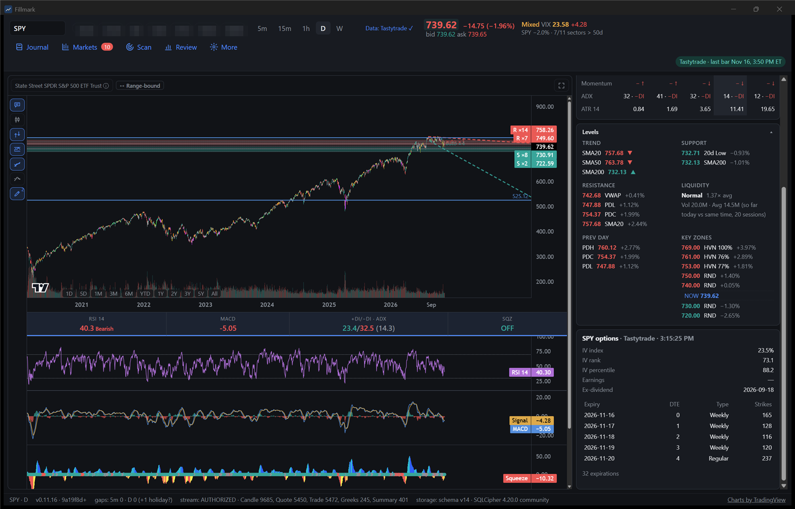

# Fillmark user guide

Fillmark is a trading journal and charting app for options and stock
traders, for Windows and Android. It reads your trades and the market and
**never places orders**. Your data stays on your own devices, encrypted.

New here? Start with **[Getting started](getting-started.md)**.

## The menu

Fillmark's menu has five groups (on the phone, the tab bar at the bottom).
Each screen has its own page:

| Group | Screen | What it's for |
|---|---|---|
| | [The chart](chart.md) | The main view: price, indicators, support and resistance, trend lines, drawings |
| | [Panels beside the chart](chart-panels.md) | Build a trade, the timeframe table, Levels, Options, the market backdrop |
| **Journal** | [Fills and imports](fills.md) | Every buy and sell your broker reported; importing, checking and cleaning up |
| | [Campaigns](campaigns.md) | Each position from open to close, with its rolls and result |
| | [Snapshots and shadows](snapshots.md) | The market at the moment you entered, exited, passed, or a rule fired |
| **Markets** | [Watchlist](watchlist.md) | Your symbols at a glance |
| | [Alerts](alerts.md) | Price, line, indicator and open-position alerts |
| | [Radar](radar.md) | Tickers scored out of 100, scanned after the close |
| **Scan** | [Radar scans](radar.md#scanning) | A daily or hourly scan from the menu bar |
| **Review** | [Study](study.md) | How trading is going and where results come from |
| | [Stats](stats.md) | Breakdowns by setup, market, timing and more |
| | [Study with AI](study-with-ai.md) | Ask Claude, ChatGPT, Gemini or a free local model about your journal |
| | [Exposure](exposure.md) | What your open positions are exposed to |
| | [Taxes (estimate)](taxes.md) | Section 1256, short- and long-term, wash sales, carryback |
| | [AI paper trading](ai-paper-trading.md) | Let an AI trade a play-money account (PC only) |
| | [Rebalancer](rebalancer.md) | Baskets at target weights, drift, dips, projection |
| **More** | [Recording](recording.md) | What Fillmark records in the background |
| | [Connections](connections.md) | Brokers and data providers |
| | [Sync and the phone](sync.md) | Your other devices, through OneDrive or Google Drive |
| | [License](license.md) | Your license or trial |
| | [Help and problem reports](help.md) | How-to guides, definitions, reporting a problem |

Also: [Privacy and security](privacy-and-security.md) (and the [privacy policy](privacy-policy.md)), what Fillmark keeps,
where, and what it never does.

## Phone and PC

Both apps have the same screens, with a few differences:

- On the phone, lists show as cards and the panels beside the chart become
  tabs under it.
- The PC does the background work (recording, scheduled scans,
  open-position alerts, AI paper trading); the phone gets the results
  through sync.
- On the phone the market tools are free; the journal and review screens
  unlock with the PC's license once paired ([License](license.md)).

## Words

Every term Fillmark uses (expectancy, R, MAE, IV rank, squeeze, trend
state…) is defined in the app: **More → Help → Definitions**, with one
search for guides and terms.

*Fillmark is a journal and analysis tool, not financial advice.*
