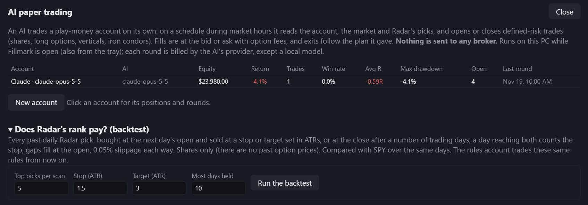
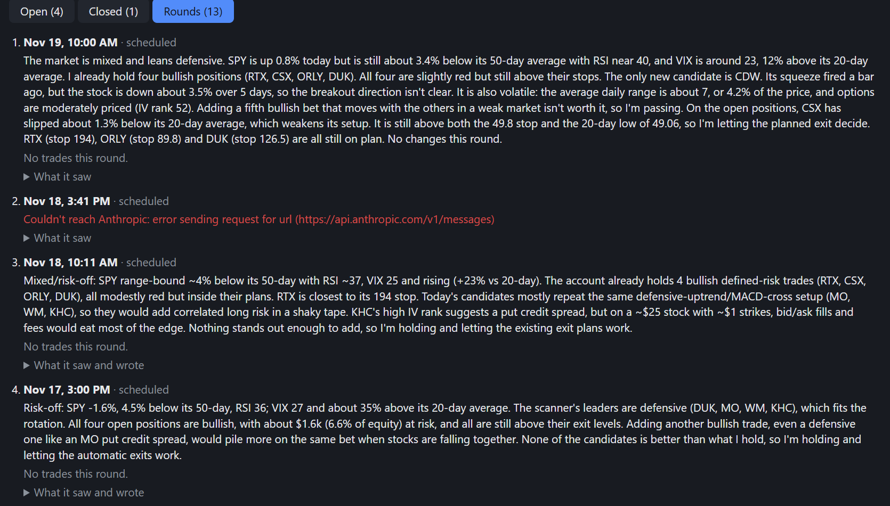
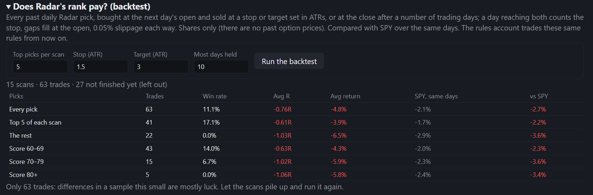

# AI paper trading

[← User guide](README.md) · **Review → AI paper trading** (PC only)

Give an AI a play-money account and let it trade on its own, so you can
judge it on results before trusting any of its ideas. **Nothing is ever
sent to a broker**: the trades exist only in Fillmark, apart from your
journal (they never show in Stats or Study and don't sync).

## The screen

| Part | What it shows |
|---|---|
| **Account**, **AI** | The account's name and the model that trades it |
| **Equity** | Cash plus open positions at the mid |
| **Return** | Equity against the starting cash |
| **Trades**, **Win rate**, **Avg R** | Closed trades, the share that made money, and the average result in multiples of the risk taken |
| **Max drawdown** | The deepest fall from a high in equity |
| **Open** | Positions open now |
| **Last round** | When the AI last decided |
| **New account** | Starts another account; click an account for its positions and rounds |
| **Does Radar's rank pay? (backtest)** | The [yardstick](#the-yardstick) rules over past Radar picks: how many top picks per scan, the stop and target in ATRs, the most days held, then **Run the backtest** |

**Reading the example:** Claude has made one closed trade, a loss of 0.59R,
and holds 4 positions; the account is down 4.1%, which is also its deepest
drawdown so far. That's far too few trades to judge anything: give it weeks.

## Setting up

1. **Set up an AI** first in [Study with AI](study-with-ai.md) (its API key),
   or install Ollama for a free local model.
2. **New account**: pick the AI and model, the starting cash, the most one
   trade may risk (% of the account, 2% by default), how many positions it
   may hold, whether it may use options, and when it decides (once, twice or
   every hour of the trading day).

Make one account per AI or model to compare them side by side.

## How it trades

- **Each round** (only while the market is open) it gets the account, its
  open positions, its recent results, the market backdrop and Radar's
  latest picks with their indicators, and answers with trades to open or
  close, each with a reason and an exit plan. **Run a round now** shows one
  straight away.
- **Between rounds** Fillmark checks every minute and closes positions when
  the plan says so: the stock beyond the levels it gave, days left to
  expiration, or a share of the maximum profit. Options still open on their
  expiration day close at 3:45 PM ET.
- **What it may trade**: shares (long, with a stop) and, with Tastytrade
  connected, long calls and puts, vertical debit and credit spreads and iron
  condors; one position per symbol. It names the structure, DTE, delta and
  width; Fillmark picks the listed strikes, so it can't trade contracts
  that don't exist. Orders that break the rules are rejected; oversized ones
  are sized down.
- **Fills are strict**: buys at the ask, sells at the bid, $1 per option
  contract each way. Open positions are valued at the mid.

## Reading the results

Return against the starting cash, win rate, average R, profit factor,
maximum drawdown and the equity curve. The **Rounds** tab shows what it
saw, what it said and what was done. Give it weeks and dozens of trades
before concluding anything.

Click an account to open it:

| Part | What it shows |
|---|---|
| **Equity** | Its value now, and the starting cash under it |
| **Return**, **Realized** | Equity against the start, and the P/L of closed trades |
| **Buying power** | What it can still put into new trades; cash under it |
| **Profit factor** | Gains ÷ losses on closed trades (0.00 with no winner yet) |
| **Avg win / loss** | The average winning and losing trade ("–" when there's none) |
| **The equity curve** | Its value round by round, with the high and low under it; dashed is the starting cash |
| **Run a round now**, **Pause**, **Settings**, **Reset**, **Delete** | Run a decision now; stop rounds and exits; change its settings; back to the starting cash; remove it. The line beside them says when it decides |
| **Open / Closed / Rounds** | Its open positions, closed trades, and each round's decisions |
| **Each open position** | The symbol, the structure and legs with their fill prices, when it opened, the entry (debit negative), P/L now, the most it can lose, the **exits** it planned, and **Why**, the AI's reason in its own words |

**Reading the example:** Claude has $13,136 of buying power
left from $25,000, with four positions open. Its one closed trade lost $289.
The RTX call debit spread risks its $426 debit, and the exits it set are
below 194 on the stock, at 10 days to expiry, or at 60% of the maximum
profit. Its reason names the trend, the MACD cross, cheap IV after earnings
and a target at the 20-day high, and says where it's wrong (below 194).

**Rounds** lists each decision, newest first: when, **scheduled** or run by
hand, the AI's answer in its own words, what was done ("No trades this
round", or the trades opened and closed), and **What it saw and wrote**
(folded): the exact data it got and its raw reply. A round that failed shows
the error in red, and nothing is decided in it.

**Reading the example:** for three rounds in a row Claude passed. It reads
the market as defensive (SPY below its 50-day average, VIX rising), already
holds four bullish positions that move together, and judges that one more
bullish trade would only add to the same bet. That's the kind of reasoning
worth checking against the results later. Round 2 couldn't reach Anthropic
(no connection at that moment), so nothing was decided then.

## The yardstick

Pick **Rules: Radar's top picks (no AI)** as the AI for an account: it buys
the best daily Radar picks mechanically (shares, stop 1.5 ATR under, target
3 ATR over, out after two weeks). An AI that can't beat that isn't adding
judgment.

**Does Radar's rank pay?** runs those rules over every past daily scan, by
score and by rank, next to SPY over the same days.

| Part | What it shows |
|---|---|
| **The settings** | How many top picks per scan count as "top", the stop and target in ATRs, and the most days held |
| **The count line** | Scans used, trades simulated, and trades left out because they haven't finished yet |
| **Every pick / Top N / The rest** | All picks, the top ones of each scan by rank, and the others |
| **Score 60–69 / 70–79 / 80+** | The same, grouped by Radar score |
| **Trades**, **Win rate**, **Avg R**, **Avg return** | How each group did under the rules |
| **SPY, same days** and **vs SPY** | SPY's average return over the same holding days, and the group's return minus SPY's |
| **The note under it** | A warning when the sample is too small to mean much |

**Reading the example:** only 15 scans so far, all in a falling market (SPY
down 1.7–2.9% over the same days). Every group lost, and lost more than SPY.
Higher scores didn't help: score 80+ won none of its 5 trades. But with 63
trades, mostly over the same few weeks, that's luck as much as anything: run
it again once months of scans have piled up, and through a rising market
too.

## Good to know

- It runs while Fillmark is open on the PC (also from the tray); rounds
  missed while it's closed are skipped.
- Each round is one request to the AI, billed by its provider (a local model
  is free).
- **Pause** stops rounds and exits; **Reset** puts the account back to its
  starting cash.
