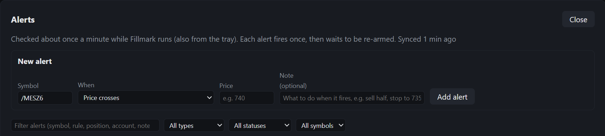
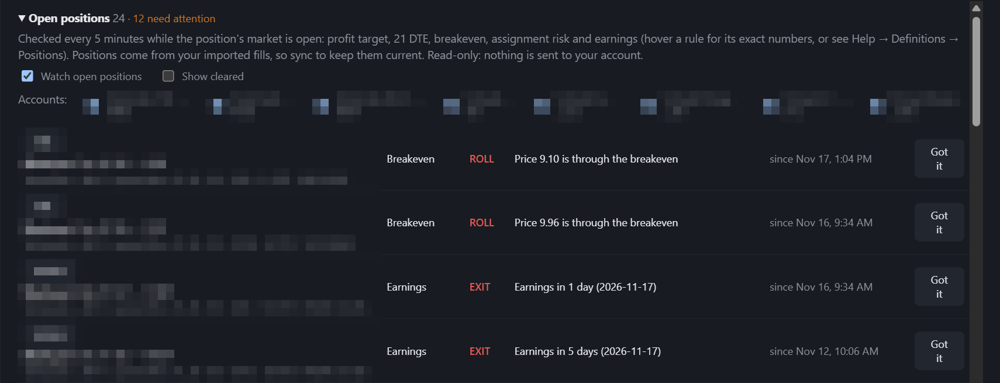
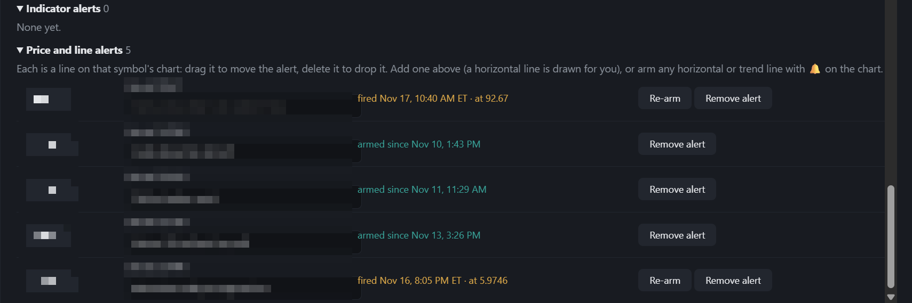

# Alerts

[← User guide](README.md) · **Markets → Alerts**

Every alert in one place, in three lists: **Open positions**, **Indicator
alerts** and **Price and line alerts**. A red number on the Markets menu (and
on the app) counts the alerts firing. When one fires you get a banner in
Fillmark and a notification, with the time of the bar it fired on (New York
time), or just the date for a daily alert.

The screen from top to bottom:

1. The heading line: alerts are checked about once a minute while Fillmark
   runs (also from the tray), each fires once and waits to be re-armed, and
   **Synced 1 min ago** says when this device last synced.
2. [New alert](#adding-an-alert): the form to add one.
3. [The filters](#managing-alerts): search and narrow the lists.
4. The three lists: [Open positions](#open-positions), then the indicator
   alerts and the price and line alerts.

## Adding an alert

- **Symbol**: starts as the symbol on the chart (here /MESZ6).
- **When**: the condition (below). Indicator conditions also ask for the
  timeframe.
- **Price**: the level, for Price crosses and the RSI conditions.
- **Note (optional)**: what you plan to do when it fires.
- **Add alert** arms it.

**New alert**: the symbol, the condition, the timeframe (5m, 15m, 1h or D)
and an optional **note**.

| Condition | Fires when |
|---|---|
| **Price crosses** | Price crosses the level. Draws a horizontal line on the chart with its alert armed |
| **RSI 14 crosses above / below** | RSI crosses the level you set |
| **Squeeze fires** | The squeeze releases |
| **Breaks an auto trend line** | A bar closes through one of the [auto trend lines](chart.md#auto-trend-lines) |
| **Retests a broken auto trend line** | Price comes back to a line it broke |
| **Trend changes** | The [trend state](chart.md#the-header-row) turns (e.g. range-bound to uptrend) |

You can also arm any horizontal or trend line on the chart with 🔔; drag the
line to move its alert.

**Notes**: what to do when it fires (e.g. "sell half, stop to 735"). The
banner and the notification show it, and it stays when you re-arm.

## Open positions

Fillmark watches your open [campaigns](campaigns.md) every 5 minutes while
their market is open.

**The header** "Open positions 24 · 12 need attention": 24 alerts are listed
(firing, or cleared with Got it while the condition still holds), and 12 of
them are firing and not yet cleared. The list puts high urgency first, then
the newest.
**Watch open positions** turns the whole monitor on or off; **Show cleared**
also lists the ones you've cleared. **Accounts** has a box per account
(broker, name and the last digits of the account number).

**Each alert row**, left to right:

| Part | What it shows |
|---|---|
| The position (pixelated here) | The ticker, then the structure and legs (e.g. "Short put · Dec 18 '26: −1 10P"), then the broker and account, the day it opened, and from its latest mark the open P/L, days to expiry (DTE) and the underlying's price |
| **Rule** | Which check fired: Breakeven, Earnings, Assignment risk, Profit target or Time exit |
| **Action** | What the rule suggests, colored by urgency (red high, orange medium, gray low): **EXIT** close the trade, **ROLL** move it out in time or strike, **WATCH** keep an eye on it |
| **Reason** | The numbers behind it, e.g. "Price 9.10 is through the breakeven", "Earnings in 1 day (2026-11-17)", "Short 160 put is in the money with $0.00 of extrinsic left" |
| **since** | When it first fired |
| **Got it** | Clears it on every synced device |

**Reading the example:** the first two rows are short puts whose stock has
fallen through the breakeven (the price at expiry where the trade starts
losing): ROLL, high urgency. The next two are short puts with earnings in 1
and 5 days: EXIT, because an earnings gap can jump past the strike.

What each rule suggests:

| Rule | Credit trade (you sold premium) | Debit trade |
|---|---|---|
| Breakeven: price through it | ROLL · high | — |
| Breakeven: within 1% of it | WATCH · low | — |
| Assignment risk | EXIT · high | EXIT · high |
| Earnings within 5 days | EXIT · high | WATCH · medium |
| Profit target (50%) | EXIT · medium | — |
| Time exit (21 DTE) | EXIT · medium | WATCH · low |

The rules:

| Rule | Alerts when |
|---|---|
| **Profit target** | A credit trade has captured 50% of its credit (at mid). Only where the credit is the most it can make: not on a risk reversal (short put, long call), which can make far more |
| **Time exit (21 DTE)** | 21 days or less to expiry, for trades opened with more |
| **Breakeven breach** | A credit trade's expiry payoff at today's price is below zero; an early warning within 1% of it |
| **Assignment risk** | A short equity option is in the money with less than $0.20 of extrinsic value per share (index options like SPX are never assigned early) |
| **Earnings inside the trade** | Earnings within 5 days |

Each says which position it means: the structure and legs (e.g. "Put credit
spread · Dec 4 '26: −2 180P / +2 175P"), the broker and account, when it
opened, and from its latest mark the P/L, days to expiry and the
underlying's price.

- **Got it** clears an alert (on every synced device); it stays listed,
  silently, until the condition clears. **Show cleared** shows those.
- **Accounts**: untick an account you only hold for the long run (e.g. DCA
  followed in the [Rebalancer](rebalancer.md)); its positions get no alerts.
- Positions come from your imported fills, so keep importing to keep them
  current. Nothing is sent to your broker.
- The PC raises these alerts and they sync to the phone, so both show the
  same list; the phone notifies you of new ones when it syncs.

## Indicator alerts and Price and line alerts

**Indicator alerts** lists the RSI, squeeze, trend-line and trend-change
alerts; "None yet" until you add one.

**Price and line alerts** lists every line with an alert. Each one is a line
on that symbol's chart: drag the line to move the alert, delete the line to
drop it. Each row:

| Part | What it shows |
|---|---|
| Symbol (pixelated) | The symbol; click to chart it |
| **Line at …** | The line's price level |
| The note box | Your note for when it fires (e.g. "sell put when reached"); type to change it |
| Status | **armed since …** (green): waiting · **fired … · at …** (orange): when it fired, in New York time, and the price it crossed |
| **Re-arm** | Only on a fired alert: arms it again, keeping the note |
| **Remove alert** | Drops the alert; the line stays on the chart |

**Reading the example:** two alerts fired (Nov 16 and Nov 17), each showing
the level it crossed, and wait to be re-armed; three are still armed.

## Managing alerts

- **Re-arm** a fired alert; **Remove** drops it (for a line alert, the line
  stays and only the alert goes).
- **Chart it** opens the symbol.
- **The filter** searches the symbol, rule, condition, position (e.g.
  "credit spread", "180P"), account or note, and narrows by type, status
  (needs attention, armed, fired, got it, cleared) or symbol.
- Each list folds away from its header, which keeps its count.
- At the top, "Synced 20s ago" shows when this device last synced.

Alerts run only while Fillmark is running: see [Recording](recording.md).
