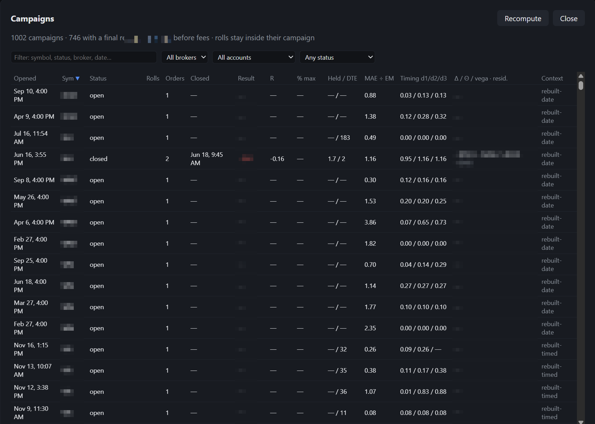
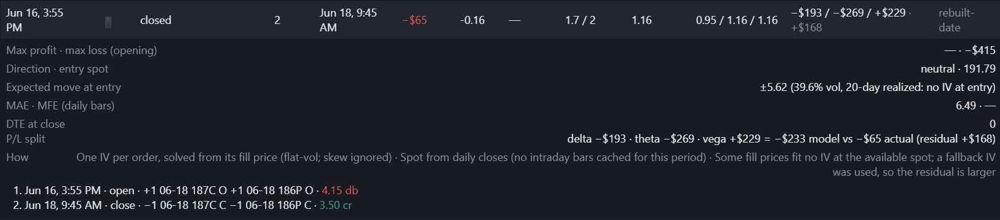

# Campaigns

[← User guide](README.md) · **Journal → Campaigns**

A campaign is one position from open to close: the opening order, every
roll and adjustment, and how it ended (closed, expired, or shares sold
after an [assignment](#assigned-shares-the-wheel)). Fillmark
builds them from your [fills](fills.md); the **open** ones are what you hold
now, as current as your last import.

## The screen

- **The summary line**: how many campaigns, how many have a final result
  (a realized profit or loss), and the total of those results before fees.
  "Rolls stay inside their campaign": a roll doesn't start a new campaign,
  so a rolled trade is judged as one.
- **Recompute**: rebuilds every campaign from the fills (it also runs each
  time the screen opens, and after fills arrive from your other device).
- **The filters**: a search box, and broker, account and status.

## The columns

| Column | Meaning |
|---|---|
| **Opened** | When the first order filled (4:00 PM when only the date is known) |
| **Sym** | The underlying |
| **Status** | **open** still holds contracts or shares (with "· 200 sh" when it holds shares) · **closed** everything closed, expired or sold, the result is final · **unsettled** past expiry, waiting for a settlement price · **incomplete** it closes something opened before your imported history, so there's no result |
| **Rolls** | How many times it was rolled |
| **Orders** | How many orders it took, all told |
| **Closed** | When it ended (— while open) |
| **Result** | Profit or loss, before fees (— while open) |
| **R** | Result ÷ the max loss of the opening position. −0.16 means it lost 16% of what it could have lost; 1.0 a gain the size of the risk. — for undefined risk |
| **% max** | Result ÷ the opening credit (credit trades): 50% means half the premium was kept |
| **Held / DTE** | Days held / days to expiration at the open (e.g. 1.7 / 2: held 1.7 days of a 2-day trade). "— / 32" for an open trade: 32 days to expiry when opened |
| **MAE ÷ EM** | The worst move of the underlying against the position ÷ the expected move at entry. Under 1: it never went against you by more than one expected move |
| **Timing d1/d2/d3** | The same, but only over the first 1, 2 and 3 trading days. 0.5 or less counts as good timing; big numbers early mean the entry came too soon |
| **Δ / Θ / vega · resid.** | The result split into direction (incl. gamma), time decay, volatility, and what the model doesn't explain (closed trades) |
| **Context** | How the [market context at entry](fills.md#the-screen) was captured: entry ✓, rebuilt-timed or rebuilt-date |

**Reading the example:** the one closed campaign shown took 2 orders over
1.7 days of a 2-day trade and ended at −0.16 R, a small loss against its
risk; its timing 0.95 / 1.16 / 1.16 says it went against the entry by about
one expected move right away. The open ones mostly show low numbers in
their first days (e.g. 0.03 / 0.13 / 0.13): good entries so far.

## A campaign's details

Click a row to open it:

| Line | What it shows |
|---|---|
| **Max profit · max loss (opening)** | The best and worst the opening position could do at expiry. **—** means unlimited (here a long straddle: unlimited profit, the most it can lose is the $415 paid) |
| **Direction · entry spot** | Bullish, bearish or **neutral** (a straddle profits from a move either way), and the underlying's price at entry |
| **Expected move at entry** | ± one standard deviation to expiry, and the volatility it came from: implied volatility, or the 20-day realized volatility when no IV was recorded at entry (as here) |
| **MAE · MFE (daily bars)** | The worst move against the position and the best move in its favor, in points of the underlying |
| **DTE at close** | Days to expiry when it ended (0: closed on expiration day) |
| **P/L split** | The result broken into **delta** (direction, incl. gamma), **theta** (time decay), **vega** (volatility), their total from the model, against the actual result; the **residual** is what the model doesn't explain |
| **How** | How the split was worked out, and anything that made it less exact (here: no intraday bars, so daily closes; a fallback IV) |
| **Plan → actual** | Only when you recorded a plan with the trade's [snapshot](snapshots.md): your profit target, time exit and stop against what happened (e.g. "target 50% → 62% · time exit 21 DTE → closed at 18 DTE · stop 2× → no loss") |
| **The orders** | Each order, numbered: when, open or close, the legs (see [Fills](fills.md#the-screen)) and the net price, **db** paid or **cr** received |

**Reading the example:** a long straddle (bought the 187 call and the 186
put) for $4.15, sold two days later for $3.50 on expiration day: −$65, or
−0.16 R of the $415 at risk. The stock moved 6.49 against it, 1.16 expected
moves, but not enough to pay for two days of time decay: theta cost $269,
direction $193, and rising volatility gave back $229. The large residual
(+$168) is flagged in **How**: some fill prices didn't fit an IV, so the
split is rougher than usual.

A line under the symbol in the row is Fillmark's own note on the campaign
(e.g. what it couldn't settle, or "Assigned: bought 200 shares at 50").

## Assigned shares (the wheel)

When an equity option ends in the money, it's assigned (or exercised) and
delivers 100 shares per contract at the strike. Those shares **stay in the
same campaign**, which stays open while it holds them:

- They're a position like any other: marked, alerted on, counted in
  [Exposure](exposure.md) and the [Rebalancer](rebalancer.md).
- **Calls sold against them** (an order that only sells calls) join the
  campaign: covered calls.
- The campaign ends when the shares are **sold**, or **called away** by an
  assigned covered call.

So a wheel is one result: for example, a put sold for $1.00 and assigned at
$50, a call sold for $0.80, then the shares sold at $52 is $100 + $80 +
$200 = **+$380** on one row. Index options (SPX, NDX, RUT…) settle in cash,
and futures options keep the future they're assigned into, the same way.

## Your notes

Your plan for a trade is recorded with its [snapshot](snapshots.md) when you
enter it (Build a trade, or a snapshot of the position): the **setup**
(the kind of trade), **tags**, the **profit target** (% of max), **time
exit** (DTE), **stop** (× credit), your **conviction** (1–5) and a one-line
**thesis**. The campaign picks them up from there: **Plan → actual**
above, [Study](study.md) and [Stats](stats.md) group results by setup and
tags, and [Study with AI](study-with-ai.md) reads your theses.

## Sorting and filtering

Click a column header to sort (again to reverse; empty values go last). The
filter box takes a symbol, broker, account, status, legs or a date; the
dropdowns narrow by broker, account or status. On the phone each campaign is
a card: tap it for the rest of its numbers and its orders.

## Related

- [Snapshots](snapshots.md): the market when the campaign opened and closed
- [Alerts → Open positions](alerts.md#open-positions): alerts on open campaigns
