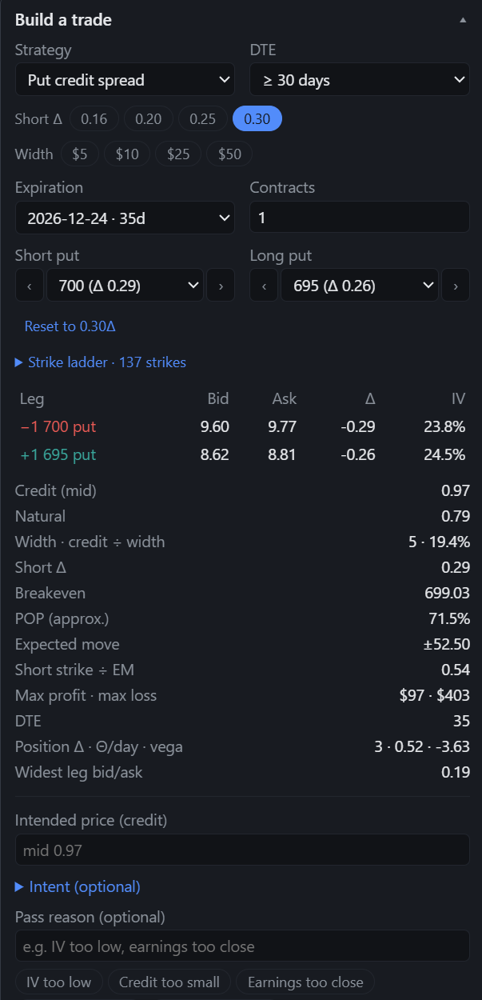
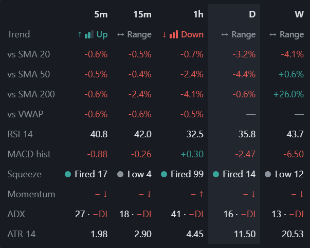
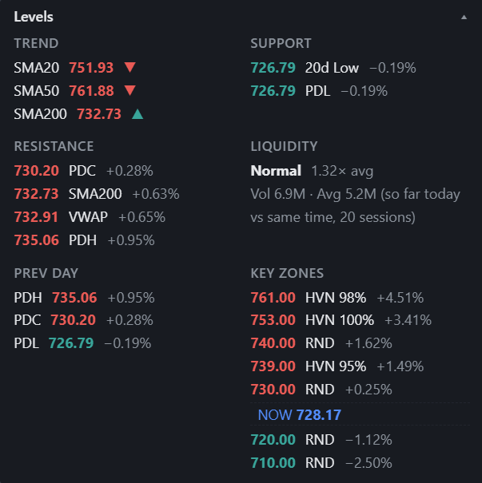
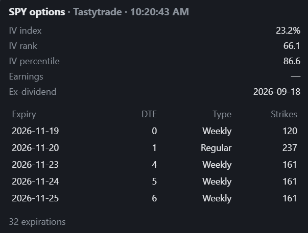

# Panels beside the chart

[← User guide](README.md)

On the PC these panels are stacked beside the chart; on the phone they're
tabs under it, one at a time (it remembers the last one). Switching tabs
keeps a trade you're building.

## Build a trade

Builds an options trade from live option prices (needs Tastytrade).

1. Pick a **strategy**: put or call credit spread, iron condor, short
   strangle, cash-secured put, naked short put or call, covered call, stock,
   or a long or short outright.
2. Set **DTE** (it picks the first expiration at least that many days out),
   the **short delta** and the **width**.
3. Read the result: breakeven, expected move, short strike ÷ expected move,
   credit ÷ width, max profit and max loss, position delta / theta per day /
   vega, the widest leg's bid/ask and an approximate probability of profit.

The ladder shows each strike's mid, bid, ask, Greeks, IV, open interest and
volume (**Columns ▾** picks which).

| Part | What it shows |
|---|---|
| **Strategy**, **DTE** | The structure, and the least days to expiration (it takes the first expiration at least that far out) |
| **Short Δ**, **Width** | The delta the short strike aims for, and the distance between strikes |
| **Expiration**, **Contracts** | The expiration chosen (change it by hand), and how many |
| **Short put / Long put** | The strikes picked, each with its delta; **‹ ›** steps a strike, **Reset to 0.30Δ** goes back to the delta's pick |
| **Strike ladder** (folded) | Every strike of that expiration |
| **The legs** | Each leg (− sold, + bought) with bid, ask, delta and IV |
| **Credit (mid)**, **Natural** | The credit at the middle of each leg's bid/ask, and at the worst prices (selling at the bid, buying at the ask) |
| **Width · credit ÷ width** | The width, and the credit as a share of it |
| **Short Δ**, **Breakeven** | The short strike's delta, and the price where it neither makes nor loses money at expiration |
| **POP (approx.)** | The chance the price ends past the breakeven at expiration (one volatility, no early exit) |
| **Expected move**, **Short strike ÷ EM** | The move the options price in by expiration, and how far the short strike is as a share of it |
| **Max profit · max loss** | Per the contracts chosen, in dollars |
| **Position Δ · Θ/day · vega** | The position's delta in shares, its decay in dollars a day, and its dollars per point of IV |
| **Widest leg bid/ask** | The widest bid/ask among the legs: wide means a costly fill |
| **Intended price** | The price you mean to trade at (the mid by default), saved with the snapshot |
| **Intent (optional)**, **Pass reason** | Your plan for the trade, or the reason you're passing, with one-tap reasons |

**Reading the example:** selling the 700/695 SPY put spread 35 days out
brings in $0.97 at the mid ($0.79 at natural), 19.4% of the $5 width: $97
to make, $403 to lose. It wins about 71.5% of the time if held to
expiration, since SPY (728) can fall about 4% to 699.03 before it loses.
The short strike sits at 0.54 of the expected move (±52.50), so a move
about half the expected size reaches it. The bid/ask is $0.19 wide on the
widest leg, so aim for the mid, not the natural.

**Your intent.** Before you trade, fill in the setup, tags, profit target
(% of max), time exit (DTE), stop (× credit), conviction and a one-line
thesis. Fillmark saves a snapshot of the trade and the market, so Study can
later compare what you planned with what happened.

**Snapshot pass.** Looked at a trade and decided not to take it? Record it
as a pass (with a reason such as "IV too low" or "earnings too close"). It's
followed as if traded: see [Snapshots and shadows](snapshots.md).

Fillmark never sends the order: place it at your broker.

## The timeframe table

The symbol on every timeframe at once (5m to weekly):

- **Trend state** (first row): when timeframes disagree, price is between
  trends or turning.
- **vs SMA 20 / 50 / 200**: how far price is above (+) or below (−) each
  average, in %.
- **vs VWAP**: intraday only.
- **RSI 14**, **MACD hist**, **Squeeze** and its **momentum**, **ATR 14**.

Hover any label for what it means.

| Row | How to read it |
|---|---|
| **Trend** | Up, Down or Range on that timeframe |
| **vs SMA 20 / 50 / 200** | Price's distance from each average on that timeframe: + above, − below |
| **vs VWAP** | Against today's volume-weighted average price; "—" on D and W |
| **RSI 14** | Over 70 stretched up, under 30 stretched down |
| **MACD hist** | + and growing: upward momentum building |
| **Squeeze** | **Fired N**: the squeeze ended N bars ago; **Low / Mid / High N**: in a squeeze of that tightness for N bars. The dot's color is the state |
| **Momentum** | Which side the squeeze momentum is on (+ / −) and whether it's rising (↑) or falling (↓) |
| **ADX** | The trend's strength (25+ strong), and which side leads: **+DI** buyers, **−DI** sellers |
| **ATR 14** | The average bar's range in points: for sizing stops and strikes |

The column of the chart's timeframe is shaded.

**Reading the example:** SPY is below its 20-, 50- and 200-day averages on
the daily and range-bound there, while the 5-minute bars are trending up: a
bounce inside a weak daily. Every timeframe has sellers ahead (−DI), and the
squeeze fired on the daily 14 bars ago with momentum negative and falling.
The daily ATR of 11.50 means a normal day moves about 1.6%.

## Levels

Folds open from its header.

- **Trend**: the moving averages, each with its price and whether it's
  rising ▲ or falling ▼ (green when below the price, red above).
- **Support** and **Resistance**: the nearest four zones below and above.
- **Prev day**: the prior day's high (PDH), close (PDC) and low (PDL), with
  the distance from the price.
- **Liquidity**: volume against its average (during the day, so far today
  against the same time of day over 20 sessions).
- **Key zones**: high-volume nodes (HVN) and round numbers (RND), top down,
  with **NOW** where the price sits.

**Reading the example:** all three averages sit above the price (red), and
the 20- and 50-day are falling (▼): overhead resistance in a downtrend. The
nearest support is the 20-day low, which is also the previous day's low
(726.79, 0.19% below); resistance starts at the previous close (730.20) and
the 200-day average (732.73). The HVN percentages are each node's volume
against the biggest one (100%). Volume is normal for the time of day (1.32×
the average).

## Options

The symbol's option backdrop, from Tastytrade: IV index, IV rank and IV
percentile, the next earnings and ex-dividend dates, and the nearest five
expirations (date, days to expiration, type, number of strikes).

| Part | What it shows |
|---|---|
| **The header** | The source and when it was fetched |
| **IV index** | The options' implied volatility now, yearly |
| **IV rank** | Where that IV sits between its 1-year low (0) and high (100) |
| **IV percentile** | The share of the past year's days with lower IV |
| **Earnings**, **Ex-dividend** | The dates Tastytrade has ("—" for none, as for an ETF's earnings). A past ex-dividend date is the last one, marked "(last)" |
| **The expirations** | The nearest five: date, days to expiration, **Weekly** or **Regular** (the monthly, third Friday), and how many strikes; the total under it |

**Reading the example:** SPY's IV of 23.2% is high for it: rank 66 and
percentile 87, so options are pricier than on most days of the past year.
That favors selling premium (credit spreads), as in the Build a trade
example. SPY lists an expiration nearly every trading day.

## The market's mood (top bar)

The top bar shows the market regime (risk-on, risk-off or mixed) and the live VIX
with its change on the day. Hover it for SPY's trend against its 50- and
200-day averages, the VIX bucket and term structure (9-day, VIX, 3-month;
above 1 means near-term stress) and how many sectors are up today. It's
recomputed every 5 minutes and saved with every snapshot, where the
**Market regime** section shows the full picture (see
[Snapshots](snapshots.md)), and [Stats](stats.md) can break results down
by it.
