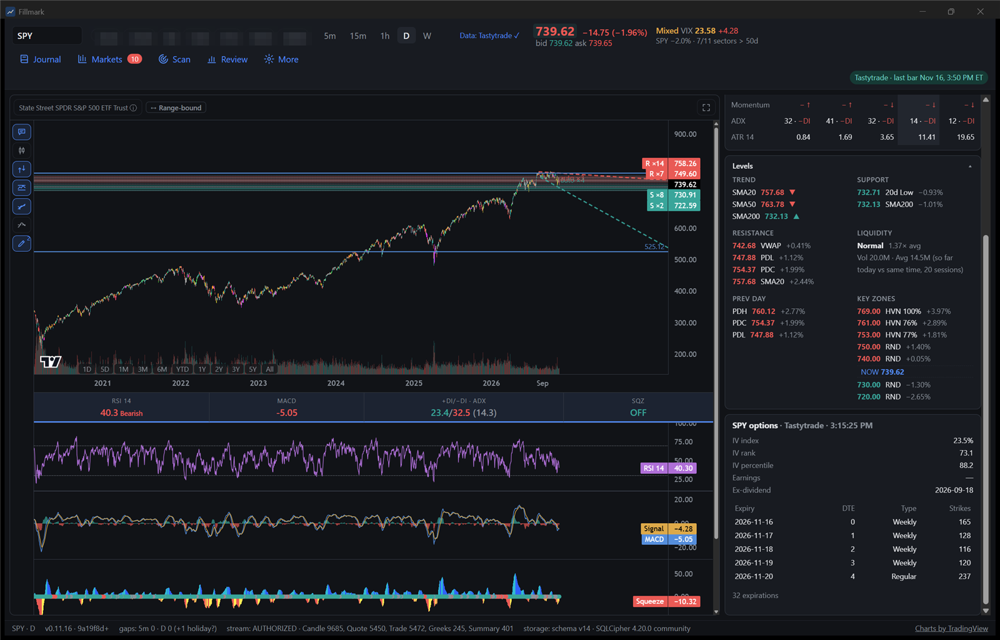

# The chart

[← User guide](README.md)

The chart is Fillmark's main view: type a symbol at the top left (SPY,
/MES for a future, BTC/USD), pick a timeframe (5m, 15m, 1h, D, W), and
recent symbols sit beside the box as chips.

On the PC the [panels](chart-panels.md) sit to the right: the timeframe table (top), Levels and Options.

## The header row

Above the chart:

- **The company name**: click it for the company card (sector, market cap,
  P/E, dividend, beta, 52-week range, average volume, next earnings; needs
  Tastytrade).
- **The trend badge**: the symbol's daily trend state: ↑ **Uptrend** or
  ↓ **Downtrend** with its strength (1–3 bars: weak, moderate, strong), or
  ↔ **Range-bound**. Beside it, **MKT** gives the same for SPY. Hover for the
  ADX and the four votes behind it. It describes price, not what to do.
- **Maximize** (the corners icon, right): fills the window with the chart
  (the whole screen on the phone); the same icon or Esc comes back. The tool
  column stays usable while maximized.

## The tool column

The column of icons to the left of the chart (beside it, so it never covers
the candles). A lit icon is on; hover one on the PC for its name; a ▾ opens
its settings as a popup, and the button whose menu is open wears an accent
ring. Only one menu is open at a time.

| Icon | What it does |
|---|---|
| OHLC balloon | Open, high, low, close and volume of the bar under the cursor |
| Candles | Candle colors and styles |
| Patterns | Candle patterns (hammer, engulfing, shooting star…) marked on the bars |
| Support/resistance | Zones where price turned before (below) |
| Trend lines | Automatic sloped support and resistance (below) |
| Moving averages | SMAs and EMAs, with their lengths and colors |
| Pencil | The drawing tools (with how many drawings there are) |

## Support and resistance zones

Swing highs and lows within half an ATR of each other form a zone, labeled
**R ×n** (resistance) or **S ×n** (support): n is how many times price came in
and was rejected. **HVN** marks a zone where heavy volume traded. The nearest
zones are drawn, half above and half below the price.

**How much to trust them:** in a test on 30 US stocks and ETFs (10 years of
daily bars, 2 of hourly), price turned back at these zones no more often than
at random levels of the same width and distance (59.2% vs 59.3%). Use them as
a map of where price turned before, not as a signal that it will again.

## Auto trend lines

Fillmark draws sloped support under price and resistance over it, dashed and
labeled **auto ×n** (how many swings touch the line).

- The menu names the shape they make (channel, wedge, triangle…) and lists
  each line.
- **Keep as a drawing** copies one into your drawings, to move, recolor or
  put an alert on.
- A line price has closed through stays a while, faded and marked "broken",
  for the retest.
- [Alerts](alerts.md) can watch for a break or a retest; [Radar](radar.md)
  can score them.

## Drawings

The pencil opens the drawing palette: horizontal lines, trend lines and
more. Drawings are kept per symbol and sync to your other devices.

- Put an alert on any horizontal or trend line with 🔔; drag the line to move
  the alert.
- Drawings follow the symbol across timeframes.

## The indicator strip

Under the chart, each indicator's value at a glance:

- **RSI 14**, with Bullish / Bearish / Overbought / Oversold
- **MACD** (green when above its signal)
- **+DI / −DI · ADX**
- **Squeeze** (ON, OFF or FIRED)

Tap a tile to show or hide its pane below the chart (▸ marks the hidden
ones). Hovering a past bar shows that bar's values. The choice is kept per
device; on the phone the panes start hidden so the chart keeps the screen.
With several panes open, the price chart keeps a minimum height and the
area scrolls.

## Where prices come from

The status at the top right says the source (Tastytrade, Alpaca, or
"Sample" for made-up prices). See [Connections](connections.md).

## Related

- [Panels beside the chart](chart-panels.md)
- [Alerts](alerts.md)
- In the app: **Help → Definitions** for every indicator
