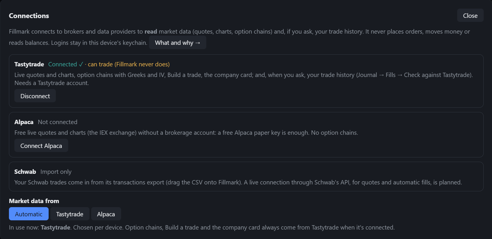

# Connections

[← User guide](README.md) · **More → Connections**

Fillmark connects to brokers and data providers only to **read**: market
data, and your trade history when you ask. It **never** places or changes
orders, moves money or reads balances. Logins and keys stay in this
device's keychain (the Keystore on the phone), never in Fillmark's database
and never synced, except when you send one to your other device yourself.

| Provider | What it gives | Needs |
|---|---|---|
| **Tastytrade** | Real-time quotes and charts, option chains, Build a trade, the company card, trade-history sync | A Tastytrade account |
| **Alpaca** | Free real-time stock quotes and charts (the IEX exchange) | A free Alpaca sign-up, no brokerage account; no option chains |
| **Schwab** | Import only: its transactions export (drag the CSV in). A live connection is planned | |
| **Nothing** | The journal, imports, Study and Stats still work; charts show made-up "Sample" prices | |

## The screen

From the top:

- **What and why →** opens Help's explanation of exactly what Fillmark
  reads and why.
- **One card per provider**, with its status next to the name:

  | Status | Meaning |
  |---|---|
  | **Connected ✓ · read-only** | Logged in with a read-only login |
  | **Connected ✓ · can trade (Fillmark never does)** | The login itself is allowed to trade (as in the screenshot). Fillmark still can't: the order addresses are blocked inside the app |
  | **Not connected** | No login on this device; the button connects it |
  | **Import only** | Schwab: trades come in from its CSV export |

  The text under each says what it gives you; **Disconnect** removes the
  login from this device's keychain.
- **Market data from**: **Automatic** (Tastytrade when connected, else
  Alpaca, else Sample prices), or **Tastytrade** / **Alpaca** only (Sample
  prices while that one isn't connected). "In use now" says which one the
  charts are using.

With more than one connected, **Market data from** picks the source for
charts (per device). Option chains, Build a trade and the company card
always come from Tastytrade when it's connected. Disconnecting removes the
login from the keychain; your journal stays.

## Connect Tastytrade

1. On Tastytrade's website, open the API / OAuth applications page (under
   your account or profile settings) and create a personal OAuth
   application. **Read scope is enough**; Fillmark asks for read-only
   tokens.
2. Create a personal grant for it: Tastytrade shows a refresh token.
3. In Fillmark, **More → Connections → Connect Tastytrade** (or click the
   data status at the top) and paste the client ID, client secret and
   refresh token.

Connections shows whether the login is **read-only** or **can trade**.
Either way, Fillmark can reach only Tastytrade's read addresses (symbols,
chains, quotes, instruments, your account list and transactions); order,
transfer and account-change addresses are blocked inside the app.

## Connect Alpaca

1. Sign up for free at alpaca.markets (the paper account; nothing to fund).
2. In Alpaca's dashboard, switch to **Paper**, then **API Keys → Generate
   New Keys**. Copy the Key ID and Secret Key (shown once). A paper key only
   ever touches play money.
3. In Fillmark, **More → Connections → Connect Alpaca** and paste both.

IEX volume is a slice of the whole market, so volume bars run lower than
elsewhere. Quotes refresh every 15 seconds, new bars every minute.

## On your other device

No need to type a login twice: once the devices are paired, **More → Sync
→ Send Tastytrade login (or Alpaca key) to phone / to PC**, then on the
other device **Scan a login** (the PC uses its camera) or **Paste a code**.
The code is encrypted with your sync key and expires in 5 minutes. See
[Sync and the phone](sync.md).
