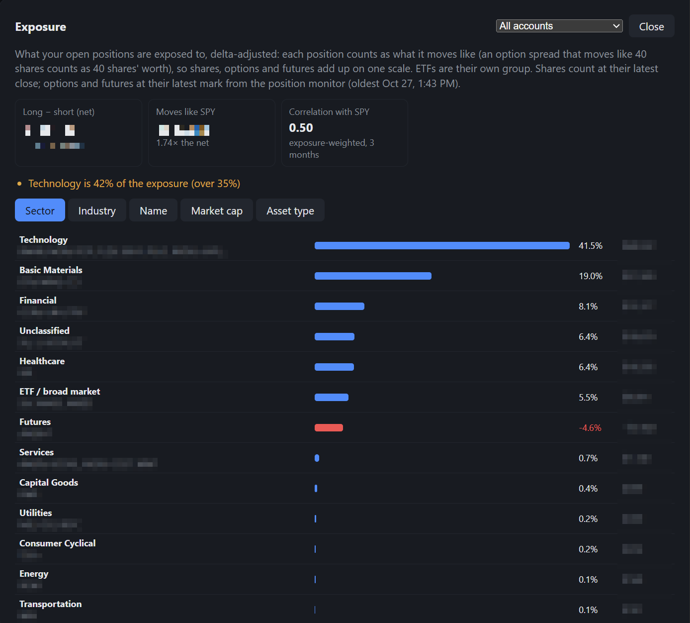

# Exposure

[← User guide](README.md) · **Review → Exposure**

What your open positions are exposed to, for all accounts or one (pick it
at the top): by **sector**, **industry**, **name**, **market cap** and
**asset type**, each as a share of the total with a bar.

## The screen

| Part | What it shows |
|---|---|
| **All accounts** (top right) | Which account to look at, or all together |
| **The description** | How positions are counted, and the time of the oldest mark used (here Oct 27): an old date means a position hasn't been marked since |
| **Long − short (net)** | Longs minus shorts, delta-adjusted; **gross** under it adds them without netting |
| **Moves like SPY** | The dollars of SPY the positions behave like, and how many times the net that is (1.74× here: the holdings swing more than the market) |
| **Correlation with SPY** | How closely they move with the market over 3 months, weighted by size. 0.50: partly with the market, partly on their own |
| **Flags** (orange) | A concentration warning, e.g. "Technology is 42% of the exposure (over 35%)" |
| **Sector / Industry / Name / Market cap / Asset type** | How to group the list |
| **Each row** | The group, the tickers in it (pixelated here), a bar (blue long, red short), its share of the exposure and its dollars |

**Reading the example:** the positions behave like 1.74× their net value in
SPY, so a 1% market drop should cost about 1.7% of the net. Technology is
41.5% of the exposure, over the 35% flag, and basic materials another 19%:
over 60% in two sectors. The one red bar is a short futures position
(−4.6%), a small hedge against the rest.

## How it's counted

- **Delta-adjusted**: each position counts as what it moves like (delta ×
  the underlying's price). An option spread that moves like 40 shares counts
  as 40 shares' worth, so shares, options and futures add up on one scale.
  Shorts count negative. Shares count at shares × the latest close.
- **Moves like SPY**: each position × its beta, summed: how many dollars of
  SPY the account behaves like.
- **Correlation with SPY**: how closely it moves with the market (near 1:
  little real diversification).

## Flags

One name over 20%, one sector over 35%, or an average correlation over
0.7.

## Good to know

- ETFs (SPY, QQQ…) are their own group: they hold many sectors.
- Sector, industry, market cap, beta and correlation come from Tastytrade.
- The numbers are as of each position's latest mark, taken by the position
  monitor while its market is open ([Recording](recording.md)).
