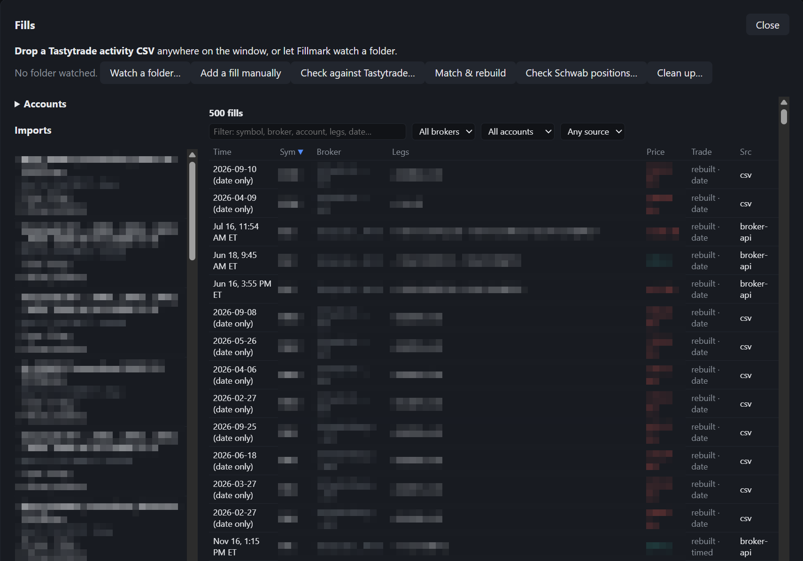

# Fills and imports

[← User guide](README.md) · **Journal → Fills**

A fill is one buy or sell your broker reported. Everything else in the
journal ([Campaigns](campaigns.md), [Study](study.md), [Stats](stats.md),
[Taxes](taxes.md)) is built from your fills, so this is where trades come
in.

## The screen

**The top row**: the folder being watched ("No folder watched") and the
tools: [Watch a folder…](#bringing-trades-in), [Add a fill
manually](#add-a-fill-manually), [Check against
Tastytrade…](#check-against-tastytrade), **Match & rebuild**, [Check
positions…](#check-positions) and [Clean up…](#clean-up).

**Match & rebuild** goes through your trades and gives each one its market
context at entry: it matches a [snapshot](snapshots.md) you took when you
entered, or rebuilds one from cached price bars.

**On the left:**
- **Accounts** (folded): the accounts found in your fills, with
  [nicknames](#several-accounts).
- **Imports**: every file or broker sync, newest first: the file name (or
  "Tastytrade API" with its accounts and date range), when and how it came
  in (**drop** a file you dragged in; **manual** a Check against Tastytrade or
  a fill you added), **N new · N dup** (fills added, and ones already
  in the journal), and **Show problems** for rows that couldn't be read.

**The fills table** ("500 fills"), with the filter box and the broker,
account and source dropdowns above it:

| Column | What it shows |
|---|---|
| **Time** | When it filled, in New York time. **(date only)**: the broker gave only the day (Schwab's regular export) |
| **Sym** | The underlying. Click any header to sort (▼ shows the sort) |
| **Broker** | The broker and account: nickname and last digits (e.g. `Schwab IRA · …623`) |
| **Legs** | Each leg: **+** bought or **−** sold, the quantity, then for options the expiration (`01-15`), strike and **C**all or **P**ut, and last **O** opening or **C** closing. `sh` is shares, e.g. `+1 sh O` bought one share to open |
| **Price** | The net price: **cr** (green) a credit you received, **db** (red) a debit you paid. Per spread for options, per share for stock |
| **Trade** | The market context of the trade it belongs to: **entry ✓** a snapshot taken when you entered; **rebuilt · timed** rebuilt from 5-minute bars at the fill's time; **rebuilt · date** only the day's bars were available (date-only fills, or older trades) |
| **Src** | Where the fill came from: **csv** an imported file, **broker-api** Check against Tastytrade, **manual** added by hand |

Click a fill to [correct it](#correcting-a-fill).

## Bringing trades in

| Broker | How |
|---|---|
| **Tastytrade, connected** | **Check against Tastytrade** (below): no file needed |
| **Tastytrade, file** | Export your activity as CSV (named like `tastytrade_activity_250224.csv`) and drag it onto Fillmark's window. If the name has no date, Fillmark asks which day it was exported |
| **Schwab** | schwab.com → Accounts → History → Export (CSV), drag it in. Dates only, no times |
| **Fidelity** | fidelity.com → Activity & Orders → History, pick the accounts and dates → Download (`Accounts_History.csv`), drag it in. Dates only, no times |
| **Vanguard** | vanguard.com → Download center, pick the account and dates, **Quicken (.qfx)** → download (`OfxDownload.qfx`), drag it in. Dates only, no times |
| **Other Quicken / Money files** | A `.qfx` or `.ofx` download from another broker is read the same way (checked only against Vanguard's so far) |
| **Schwab with times (thinkorswim)** | Monitor → Account Statement, set From and To, then the menu at the top right → Export to File. Drag it in. Exact execution times (New York) and fees |
| **Anything else** | **Add a fill manually** |

Drop a file anywhere on the window. Importing the same file again never
counts a trade twice; each import is listed with what was added, skipped as
a duplicate, or couldn't be read (**Show problems**).

**Schwab notes:**
- Interest, transfers, fees, shares journaled between accounts, splits and
  Schwab's Expired / Assigned rows are listed as skipped: Fillmark settles
  expiries and assignments itself.
- Same-day option rows join into one order only when they look like one (a
  spread or a roll).
- A thinkorswim statement replaces the date-only fills of its account and
  days; futures in a statement aren't read yet.

**Fidelity notes:**
- One file can hold several accounts; each fill gets its own (the last four
  digits of the account number).
- 529 portfolios have no ticker: the fund code in brackets after the fund's
  name stands in for one, so Fillmark has no prices for them.
- Deposits, dividends, interest and fees are listed as skipped, and so are
  option expiries and assignments and the shares delivered for them:
  Fillmark settles those itself.
- Options follow Fidelity's published layout and haven't been checked
  against a real options file yet. A row that doesn't read is listed under
  **Show problems**; a problem report helps.

**Vanguard notes:**
- Use the **.qfx**. Vanguard's CSV leaves the contract out of option rows
  for contracts no longer held, so those rows can't be read (they're listed
  as errors).
- Options are read from each trade's description ("PUT NVIDIA CORP $170 EXP
  11/13/26"), which names the company, not the ticker. Fillmark matches the
  name to the stocks in the file and a list of common ones; a company it
  can't match is listed as an error by name, to add by hand.
- Each fill gets its account's last four digits. Money-market sweeps and
  dividends are skipped.
- A roll's two legs on one day join into one order, even when the file
  lists them apart.
- A split adds its new shares as a $0 buy: the share count comes right and
  the total cost stays. A reverse split is listed, to adjust by hand.
  Vanguard's .qfx sometimes leaves a split out; **Check positions…** shows
  it.
- Don't import both the .qfx and the CSV for the same dates: the trades
  would be doubled.

**Watch a folder…** (e.g. Downloads): Tastytrade exports saved there import
by themselves. Schwab, Fidelity and Vanguard files still need dragging in.

## Check against Tastytrade

With Tastytrade connected: pick the accounts and dates, and Fillmark reads
your transactions (read-only) and compares them with the journal: orders
that **agree**, **disagree**, are **not in the journal**, or that Fillmark
still holds open. Nothing is saved until you import. Covers stock, equity
and index options, futures, futures options and crypto.

## Add a fill manually

Pick the broker, the underlying, the date and time (ET; the time is
optional), the net price, whether it was a credit or debit, and the fees
(optional). Then the legs (**+ option leg**, **+ stock leg**): buy or sell,
open or close, quantity, and for options the call/put, strike and
expiration. Use **Set account…** afterwards if the broker has several
accounts. Price is per spread for options, per share for stock, or per
100-share unit for stock with options.

## Correcting a fill

Click a fill to edit it (price, net price, credit/debit) and **Save
correction**; **Revisions** shows its history. Corrected fills are kept when
the same file is imported again.

## Several accounts

Positions are kept per account. Fillmark shows an account by its last
digits (`…1234`).

- **Accounts**: give each a nickname (IRA, Swing…); it shows as
  `IRA · …1234` everywhere, on every synced device. The AI export never
  includes nicknames.
- Schwab, Fidelity and Vanguard files carry the account; a Tastytrade CSV doesn't. Fills with no
  account count toward the broker's only account. With several accounts,
  an import with such fills says so: **Set account…** picks which one.

## Check positions…

To catch a missing or doubled import, compare what the broker says you hold
with what Fillmark worked out from your fills:

- **Schwab:** on schwab.com, Accounts → Positions → Export (one account at
  a time), then drag it in or use **Check positions…**. It's only
  compared, never imported.
- **Vanguard** (or another Quicken download): the .qfx lists the holdings
  too. Import it, then **Check positions…** and pick the same file. Only
  shares and funds are compared (Vanguard's file doesn't say which option
  contracts are held); the money market is left out.

Each holding that differs is listed with both quantities; all matching
shows ✓. Usual causes: a transactions export that doesn't go back far
enough, a split the file didn't report, or fills in the wrong account.

## Clean up…

For a bad import or a closed account: pick the broker and account (or every
account of a broker). Fillmark shows what will go (fills, edits, imports,
and the campaigns, position marks and alerts left with no fills).

- Snapshots stay unless you tick **Also remove the snapshots**.
- **Start fresh → Everything** clears the whole journal. Settings,
  connections, drawings, watchlists, alert lines, Radar and recorded market
  data stay.
- **Save a backup first** (required for Start fresh): an encrypted copy of
  the whole journal in Fillmark's `backups` folder.
- Paired devices do the same cleanup at their next sync.

## Sorting and filtering

Click a column header to sort (again to reverse). Type in the filter box
(symbol, broker, account, status, legs or a date like "Oct 3"); every word
must match. The dropdowns narrow by broker, account, source or status.
