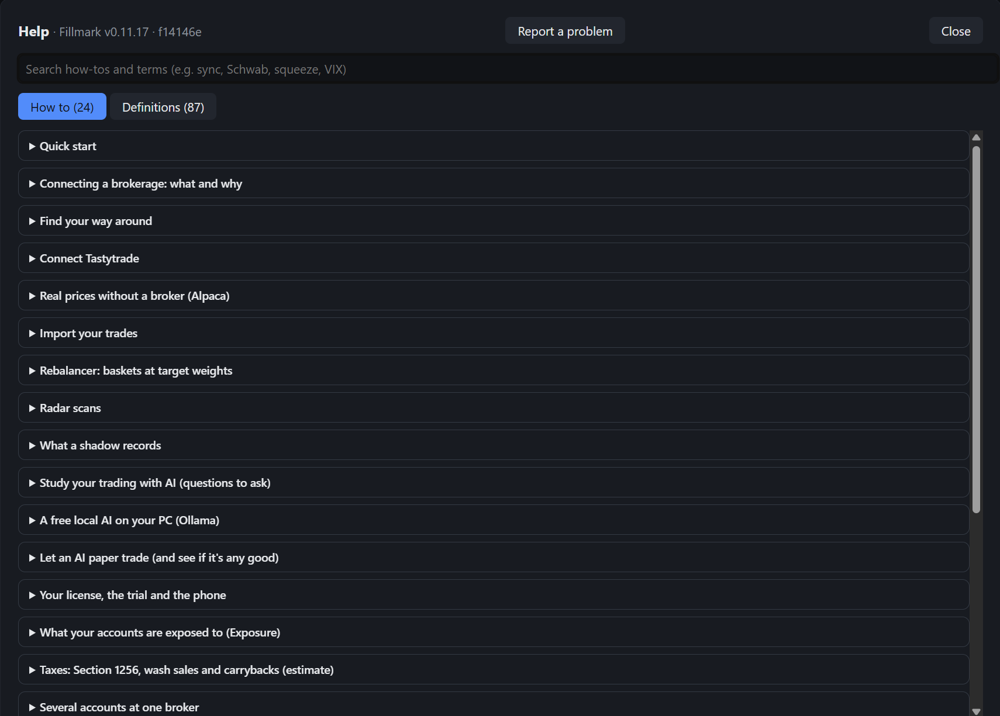
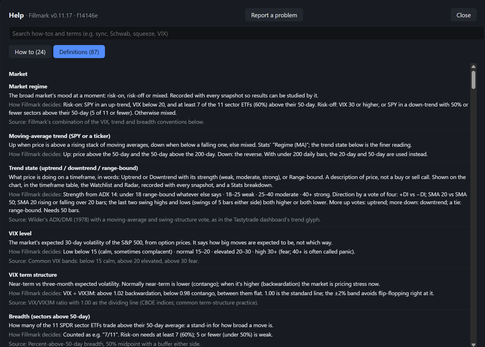
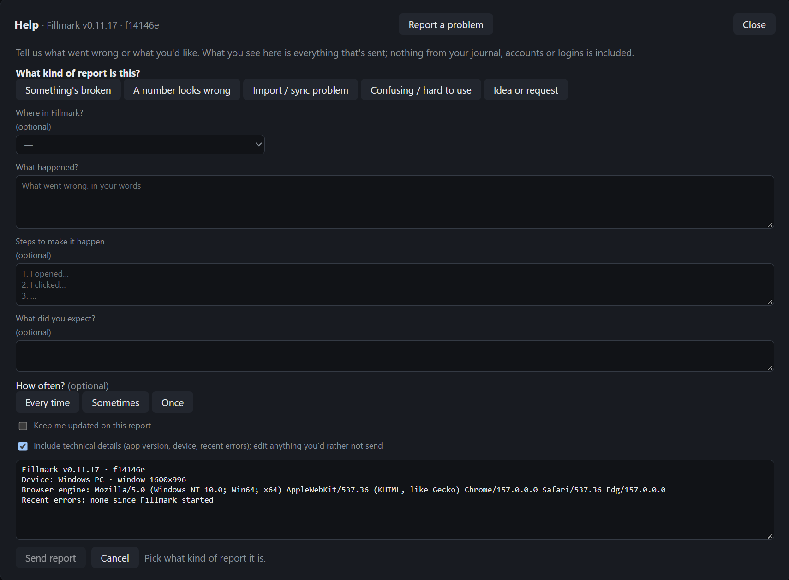

# Help and problem reports

[← User guide](README.md) · **More → Help**

## Help

| Part | What it does |
|---|---|
| **Help · Fillmark v0.11.17 · f14146e** | The version you're running (quote it in a problem report) |
| **User guide ↗** | Opens this guide in your browser |
| **Report a problem** | Opens the [report form](#report-a-problem) |
| **Search** | Searches the guides and the definitions together (e.g. sync, Schwab, squeeze, VIX) |
| **How to (24)** / **Definitions (87)** | The two tabs and how many entries each has (or how many match your search) |
| A guide (▶) | Click to open it; click again to fold it |

One search box for both:

- **How to**: step-by-step guides (getting started, connecting, importing,
  sync, the Rebalancer, AI, taxes…).
- **Definitions**: every term and number Fillmark shows, with what it means,
  how it's worked out, and where it comes from (expectancy, R, MAE, IV rank,
  squeeze, trend state, market regime, each Radar signal and alert rule).

### Definitions

Grouped by topic (Market, Indicators, Positions, Radar, Rebalancer…). Each
entry has three parts:

| Part | What it says |
|---|---|
| **The name and first line** | What it is, in plain words |
| **How Fillmark decides** | The exact rule and numbers (e.g. trend state: ADX under 18 range-bound, 18–25 weak…) |
| **Source** | Where the convention comes from (e.g. Wilder 1978), or "Fillmark's" when it's Fillmark's own |

When a screen shows a label and you want to know exactly how it's worked
out, search its name here: these entries come from the same code the app
uses, so they stay in step with it.

Most labels in the app also explain themselves when you hover them.

The title shows the version: year.month.day of the build, then the commit
it was built from (e.g. v0.11.9 · 27e2524). A "+" means it was built with
changes not yet committed.

## Report a problem

**Report a problem** at the top of Help:

| Part | What it's for |
|---|---|
| **What kind of report is this?** | Something's broken · A number looks wrong · Import / sync problem · Confusing / hard to use · Idea or request. Required: **Send report** waits for it ("Pick what kind of report it is.") |
| **Where in Fillmark?** | The screen it's about (optional) |
| **What happened?** | In your own words |
| **Steps to make it happen** | What you did, in order (optional, but the quickest way to a fix) |
| **What did you expect?** | Optional |
| **How often?** | Every time · Sometimes · Once (optional) |
| **Keep me updated on this report** | Tick and add your email for a reply; unticked, the report is anonymous |
| **Include technical details** | The box below shows exactly what's added: the version, the device and window size, the browser engine, and recent errors ("none since Fillmark started" here). Edit or delete anything, or untick it |
| **Send report** / **Cancel** | Sends it, or closes the form |

1. Pick the kind (something broken, a number that looks wrong, an import or
   sync problem, something confusing, or an idea) and where in Fillmark.
2. Say what happened, the steps to make it happen, what you expected and
   how often.
3. Tick **Keep me updated on this report** and add your email if you'd like
   a reply; without it the report is anonymous.

Fillmark adds the app version, the device and its recent errors, which you
can read, edit or leave out. Anything in those errors that looks like a
key, token, account number or email address is replaced ("[api key]",
"[account]"…). Everything sent is on screen before you send it; nothing
from your journal, accounts or logins is included.
