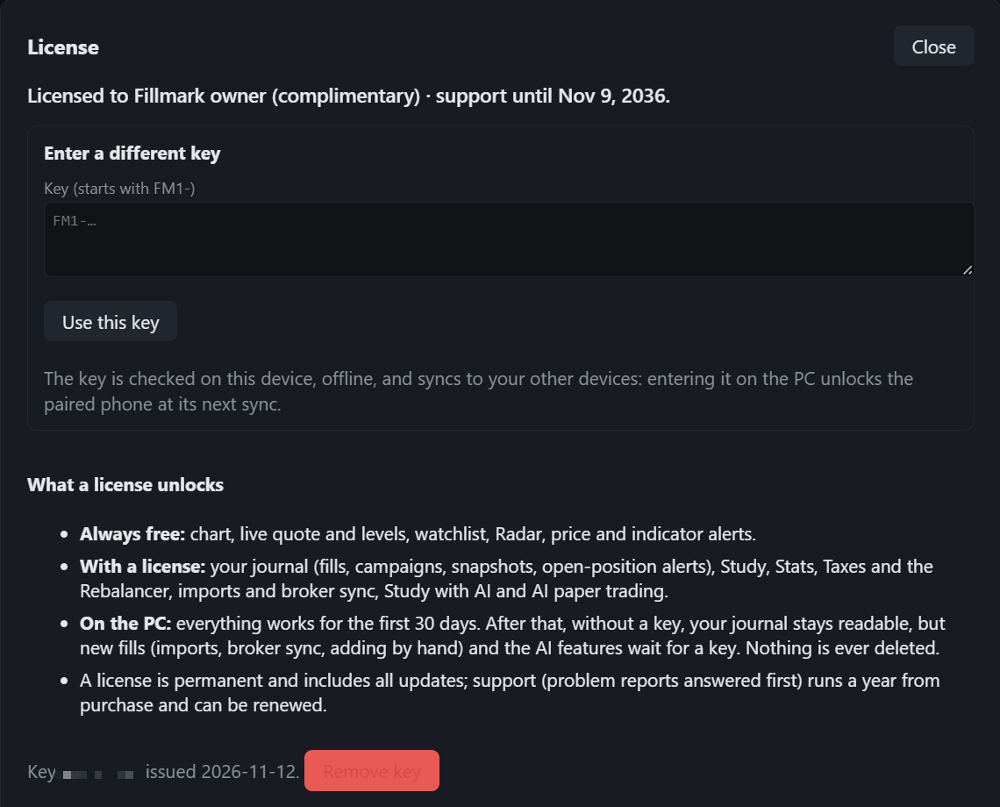

# License

[← User guide](README.md) · **More → License**

Shows this device's license or trial and takes a key (it starts with
`FM1-`). Keys are checked on the device, offline, and sync to your other
devices.

## The screen

| Part | What it shows or does |
|---|---|
| **The status line** | Who it's licensed to and until when support runs (here a complimentary license, support until Nov 9, 2036). Without a key: the trial's days left, or that it has ended |
| **Enter a different key** | Paste a key (starts with `FM1-`) and **Use this key**. It's checked right here, offline, and syncs to your paired devices |
| **What a license unlocks** | What's always free, what needs a license, and the PC's 30-day trial |
| **Key … · issued …** | The installed key's short ID (pixelated here) and the day it was issued: quote the ID if you ever need help with your license |
| **Remove key** | After a confirmation, takes the key off this device and, at their next sync, your other devices; the journal stays. Enter the key again to unlock |

## On the PC

Everything works for the first **30 days**. After that, without a key,
your journal stays readable, but new fills (imports, broker sync, adding by
hand) and the AI features wait for a key. Nothing is ever deleted.

## On the phone

Free: the chart, live quotes, levels, watchlist, Radar, and price and
indicator alerts.

With a license: your journal, open-position alerts, Study, Stats, Taxes,
Exposure and the Rebalancer. Pair the phone with your licensed PC and the
license arrives with the first sync, or enter a key on the phone. Locked
menu items show a 🔒.

## What a license includes

A license is permanent and includes all updates. Support (problem reports
answered first) runs a year from purchase and can be renewed.
