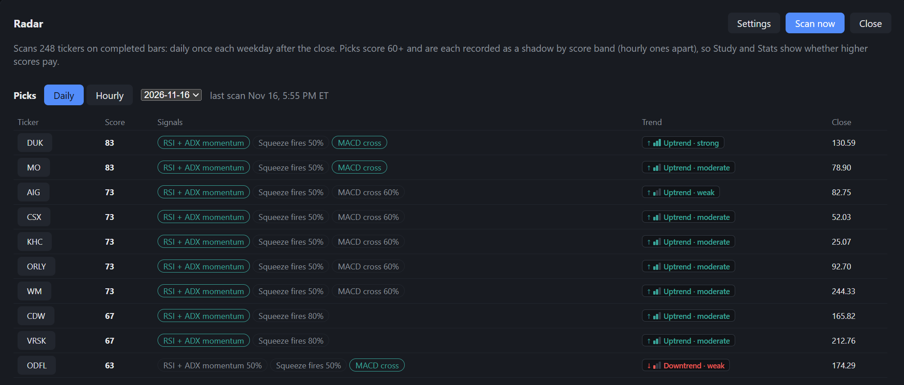
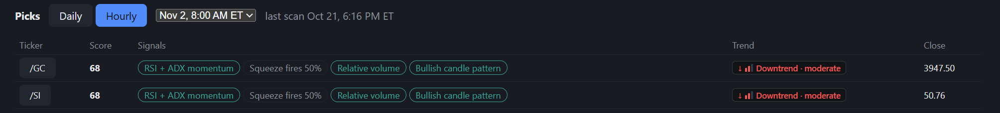
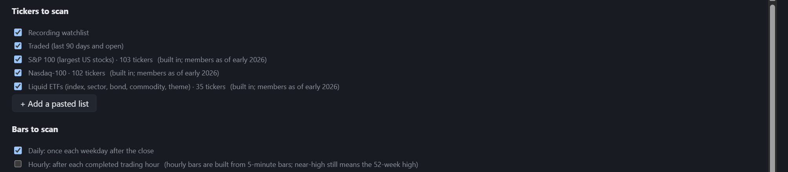
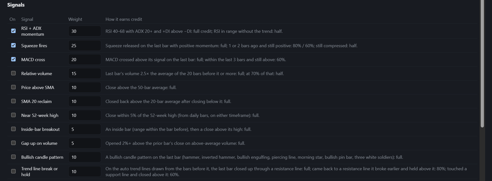
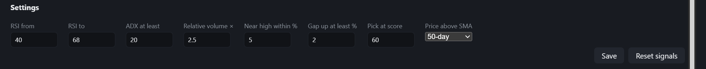

# Radar

[← User guide](README.md) · **Markets → Radar**

Radar scores tickers out of 100 from a weighted mix of signals, on daily or
hourly bars, and lists the best as **picks**. Each pick is recorded as a
[shadow](snapshots.md), so [Study](study.md) can tell you later whether
higher scores actually did better.

## The picks screen

From the top:

| Part | What it does |
|---|---|
| **Settings** | The signals, their weights, and what to scan ([below](#how-a-score-works)) |
| **Scan now** | Runs a scan now, in the background |
| The description | How many tickers are scanned (here 248), when, and the pick threshold (60+) |
| **Daily / Hourly** | Which picks to show |
| The date box | The scored bar: the day (daily) or the hour in New York time (hourly). Past scans stay here |
| **last scan** | When this device last ran that kind of scan |

Each pick row:

| Column | What it shows |
|---|---|
| **Ticker** | Click to chart it |
| **Score** | 0–100: the share of the enabled signal weights it earned |
| **Signals** | One pill per signal that earned credit. **Green outline**: full credit. **Gray with a %**: partial credit (e.g. "Squeeze fires 50%": the squeeze released a bar or two ago, or is still compressed). Hover a pill for the numbers and its rule |
| **Trend** | The [trend state](watchlist.md#the-trend-chip) on that timeframe |
| **Close** | The close of the scored bar |

**Reading the example (daily, Nov 16):** DUK and MO score 83. Both earned
full credit for RSI + ADX momentum (30) and the MACD cross (20), and half for
the squeeze (12.5 of 25): 62.5 of the 75 default weights, 83. The seven at
73 have the MACD cross at 60% (it crossed within the last 3 bars, not on the
last one). CDW and VRSK at 67 have no MACD cross but a fuller squeeze
credit (80%). ODFL scrapes in at 63 with a **downtrend**: the signals turned
up, but the trend hasn't yet, so it's an early, riskier pick.

### Hourly picks

The same table for one hour's bar (here Nov 2, 8:00 AM ET). /GC (gold) and
/SI (silver) score 68 from momentum, relative volume and a bullish candle
on the hour, inside a moderate downtrend: a bounce setup, not a trend
follow. Hourly picks are recorded as shadows apart from the daily ones, so
Study compares them separately.

## Settings

**Settings** (top right; **Hide settings** closes it) has four parts, top to
bottom: what to scan, which bars, the signals, and the numbers.

### Tickers and bars to scan

- **Tickers to scan**: tick each list to include. Overlaps count once (here
  the five lists make 248 tickers).
  - **Recording watchlist**: your [watchlist](watchlist.md).
  - **Traded (last 90 days and open)**: what you've traded recently or
    still hold.
  - **S&P 100**, **Nasdaq-100**, **Liquid ETFs**: built-in lists (members
    as of early 2026), off until you tick them.
  - **+ Add a pasted list**: paste tickers and name the list.
- **Bars to scan**:
  - **Daily**: once each weekday after the close.
  - **Hourly**: after each completed trading hour. Hourly bars are built
    from 5-minute bars. Off here, which is why "last scan" for Hourly is an
    old date.

### Signals

One row per signal: **On** includes it in the score, **Weight** is how many
points it's worth, and **How it earns credit** is its exact rule, using the
numbers you set below (the screenshot's RSI range is 40–68 because it was
changed from the default 55–68). The three on by default (momentum 30,
squeeze 25, MACD 20) make 75 points; the score is out of the points of the
signals that are on, so turning more on doesn't inflate scores.

### The numbers

| Setting | Default | What it changes |
|---|---|---|
| **RSI from** / **RSI to** | 55 / 68 | The RSI band for the momentum signal: strong but not yet overbought. Lower "from" (e.g. 40) also counts early recoveries |
| **ADX at least** | 20 | How strong the trend must be for full momentum credit |
| **Relative volume ×** | 2.5 | How many times the 20-bar average volume counts as a volume surge |
| **Near high within %** | 5 | How close to the 52-week high counts as "near" |
| **Gap up at least %** | 2 | How big an opening gap counts |
| **Pick at score** | 60 | The score a ticker needs to be a pick (and recorded as a shadow) |
| **Price above SMA** | 50-day | Which average (20, 50 or 200-day) the Price above SMA signal uses |

**Save** keeps the changes (the next scan uses them; picks already made
keep their scores). **Reset signals** puts the signals and these numbers
back to the defaults; your ticker lists stay.

## How a score works

Each signal you turn on earns its weight × its credit (0 to 1); the score is
the earned share of all enabled weights, out of 100. Picks need 60 or more
by default.

| Signal | On by default | Earns credit when |
|---|---|---|
| RSI + ADX momentum | ✓ (30) | RSI 55–68 with ADX 20+ and +DI above −DI (half credit without the trend) |
| Squeeze fires | ✓ (25) | The squeeze released on the last bar with positive momentum (less for 1–2 bars ago; half while still compressed) |
| MACD cross | ✓ (20) | MACD crossed above its signal on the last bar (60% within the last 3) |
| Relative volume | (15) | Volume 2.5× the 20-bar average or more |
| Price above SMA | (10) | Close above the 50-bar average |
| SMA 20 reclaim | (10) | Closed back above the 20-bar average after closing below it |
| Near 52-week high | (10) | Close within 5% of the 52-week high |
| Inside-bar breakout | (5) | An inside bar, then a close above its high |
| Gap up on volume | (5) | Opened 2%+ above the prior close on above-average volume |
| Bullish candle pattern | (10) | A bullish pattern on the last bar |
| Trend line break or hold | (10) | A close up through an auto resistance line, a held retest of one, or a bounce off support |

Hover a signal in Radar for its exact rule (**How it earns credit**). Change
the weights and numbers to your taste; **Reset signals** goes back to the
defaults (your lists stay).

## What it scans

- **Tickers to scan**: your [watchlist](watchlist.md) and the tickers you've
  traded (both on), plus built-in lists, off until chosen: **S&P 100**,
  **Nasdaq-100**, and **Liquid ETFs** (index, sector, bond, commodity,
  theme).
- **+ Add a pasted list**: paste tickers (AAPL, MSFT, NVDA…) and name the
  list.
- **Bars to scan**: daily, hourly or both.

## Scanning

- **Scan now** in Radar, or quicker, **Scan** in the menu bar → **Daily
  scan** or **Hourly scan** without opening Radar. The button counts the
  tickers done (12/80); tap it to open Radar. It keeps going if you close
  Radar or the window.
- A scan uses **closed bars only, never the live price**. The daily scan
  scores each ticker on its last closed day: during the trading day that's
  yesterday; today's bar counts once the market closes at 4:00 PM ET.
- Scheduled scans run only while Fillmark is running; a missed one isn't
  made up. Only one scan runs at a time.
- When a scan you started finishes with Radar closed, a banner says how many
  picks it found; **Show** opens them.
- With Tastytrade connected, each pick is checked against the real option
  chain, so a big scan takes a few seconds per pick.

## Picks and past scans

Each pick shows its score, the scored bar (the day, or the hour in New York
time), the trend state on that timeframe, and which signals hit. **Chart
it** opens the symbol. Past scans stay listed.

**Does the rank pay?** [AI paper trading](ai-paper-trading.md) has a
backtest that runs Radar's rules over every past daily scan, by score and
by rank, against SPY.
