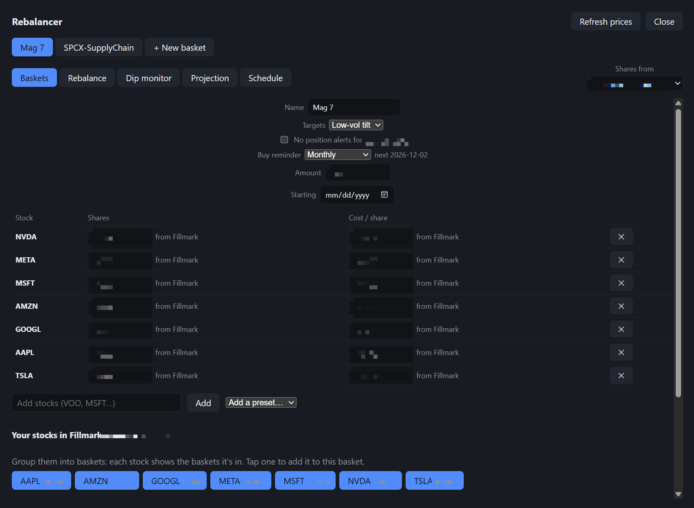
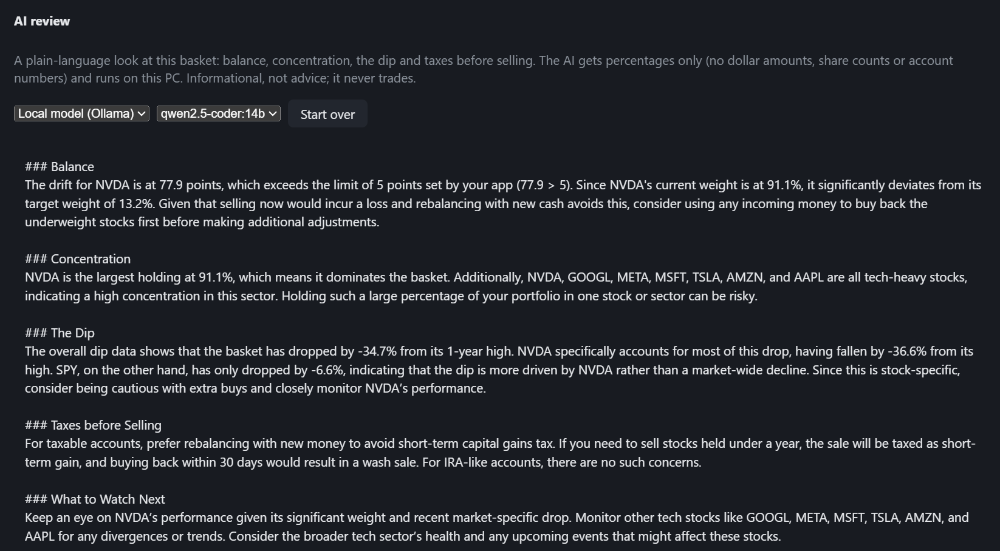
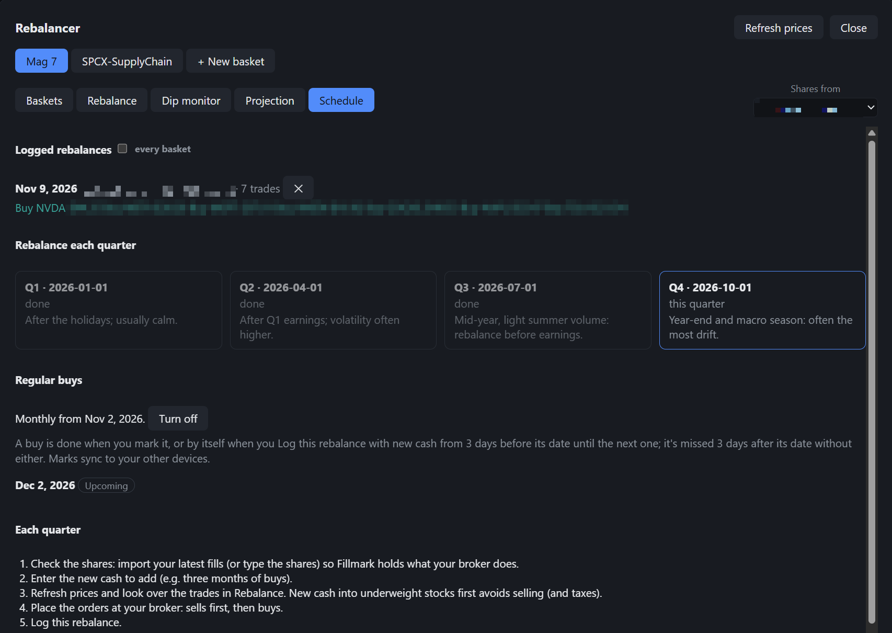

# Rebalancer

[← User guide](README.md) · **Review → Rebalancer**

For long-term holdings: a **basket** is a group of stocks you keep at target
weights, for example your long-term holdings or one account's. Start one
empty or from a preset (Mag 7, S&P core…); you can have several. Fillmark
never sends orders, and none of this is advice.

**Shares from** sits beside the tabs, so you can switch accounts from any
of them: every broker, one broker, or one account, worked out from your
fills.

## Baskets

| Part | What it shows |
|---|---|
| **Basket tabs** (Mag 7, SPCX-SupplyChain, + New basket) | Your baskets; **+ New basket** starts one empty or from a preset |
| **Baskets / Rebalance / Dip monitor / Projection / Schedule** | The five views of the basket picked above |
| **Shares from** (top right) | Which account's shares to use: every broker, one broker, or one account |
| **Refresh prices** | Fetches the latest prices for the basket's stocks |
| **Name**, **Targets** | The basket's name and how its weights are set (your own, equal, or low-vol tilt) |
| **No position alerts for …** | Turns off open-position alerts for that account |
| **Buy reminder**, **Amount**, **Starting** | The [regular buy](#regular-buys) plan; "next" is the next buy date |
| **Stock / Shares / Cost / share** | Each stock in the basket. "from Fillmark" means the number is worked out from your fills; type over it to override. **×** removes the stock |
| **Add stocks**, **Add a preset…** | Add tickers by hand or a whole preset |
| **Your stocks in Fillmark (account)** | Every stock you hold in that account, with its shares; each chip lists the baskets it's in. Tap one to add it to this basket |

**Reading the example:** Mag 7 holds the seven stocks with shares and costs
taken from the fills, weighted with a low-vol tilt, and a monthly buy
reminder (the next one Dec 2). All seven stocks held in the account
are already in the basket.

- **Your stocks in Fillmark** lists what you hold and which basket each is
  in: tap one to add it, or add every stock not in a basket.
- **Shares**: type a number to override Fillmark's (↺ goes back).
- **Cost / share**: the average cost from your fills (fees included; shares
  from an assignment at the strike), blank when the history is incomplete;
  type your own to override it.
- **Targets**: your own weights, equal, or a **low-vol tilt** (calmer stocks
  get more).
- **By account**: each account apart: its value, its cost (shares × cost per
  share) and the cash put in, which you can set or leave following the
  cost. Click an account to correct its cost per share (e.g. shares bought
  before your imported history).
- **No position alerts for …**: tick it for an account you only buy and
  hold; its positions get no [open-position alerts](alerts.md#open-positions).

## Rebalance

Each stock's share of the basket now against its target, the drift, and the
trade that brings it back (in dollars and shares), with any new cash you
add. Drift over 5 points means it's time.

| Part | What it shows |
|---|---|
| **Value now** | The basket's value at the prices below, and whose shares it uses |
| **New cash to add** | Money you're putting in now; the trades spend it. "after" is the value once it's in |
| **Largest drift** | The biggest gap between a stock's share and its target, in percentage points; over 5 says rebalance |
| **Prices** | The date of the prices used: the daily close (today's while the market is open). **Refresh prices** updates them |
| **Price**, **Day** | The latest price and today's change |
| **vs high** | How far it is below its 52-week high |
| **Vol** | Its 90-day volatility, annualized (what the low-vol tilt uses) |
| **Value**, **Now**, **Target** | Its value, its share of the basket now, and the share it should have |
| **Drift** | Now − Target: positive (orange +) is overweight, negative is underweight |
| **Trade** | What brings it back to target: **Sell** (red) or **Buy** (green), in dollars and shares |
| **Unrealized** | Gain or loss against the cost per share, in dollars and % |
| **The line below** | The orders to place, sells first so they free the cash for the buys |
| **Log this rebalance** | Records the trades and the new cash in [Schedule](#schedule) |

**Reading the example:** NVDA has grown to 91% of the basket against a 13%
target (drift +77.9 points), so the plan is to sell most of it and spread
the proceeds over the other six, each 10–19 points underweight. A low-vol
tilt gives AAPL the biggest target (21%, the calmest at 26% volatility) and
TSLA the smallest (10.7%, the most volatile at 51%). Selling NVDA would
realize its loss (red in Unrealized): check taxes first, and consider using
new cash instead of selling.

Place the orders at your broker, sells first, then **Log this rebalance**:
it adds the cash to the basket's "put in" (to its account when the basket
covers one account with a "put in" set, otherwise to the basket's
unassigned total, which **Edit** corrects).

**AI review**: the AI you set up in [Study with AI](study-with-ai.md) reads
the basket in **percentages only** (no dollar amounts, share counts or
account numbers) and reviews its balance, concentration, the dip and taxes
before selling. Ask follow-ups below its answer; **What's sent** shows
exactly what it got.

| Part | What it shows |
|---|---|
| **The two dropdowns** | Which AI (here a local model through Ollama, so nothing leaves the PC) and which of its models |
| **Review this basket / Start over** | Asks for a review; once there's an answer, starts a fresh one |
| **The answer** | Balance (drift against the 5-point limit), Concentration, The Dip (market-wide or stock-specific), Taxes before selling, and What to watch next |
| **Ask a follow-up** (below the answer) | Ask more about the same basket, e.g. "what if I add TSLA?" |
| **What's sent** (folded) | The exact data the AI got: percentages only |

**Reading the example:** the review sees what the Rebalance table shows (NVDA
91% against a 13% target) and suggests rebalancing with new money rather
than selling at a loss. It reads the dip as NVDA's own (the basket down
34.7% from its high, SPY only 6.6%), so extra buys call for caution. Check
its numbers against the tables: a small local model can get details wrong.

## Dip monitor

How far the basket is below its 1-year high, **from prices only**: the
shares held now applied to each day's close, so buying, selling or switching
accounts never fakes a dip. Tiers at −10%, −20% and −30% for your plan's
extra buys.

| Part | What it shows |
|---|---|
| **Basket value** | What your shares are worth now |
| **1-year high** | The basket's highest close in the past year, with its date |
| **From high** | How far below that high it is now, and the tier it has reached |
| **SPY from its high** | The same for the market, to compare |
| **The orange line** | Market-wide or stock-specific, and which stock is behind it |
| **The line under it** | A warning when one holding is over a quarter of the basket |
| **The tier ruler and cards** | −10% normal dip, −20% bear market, −30% crash. A red card is reached; **Mark as bought** records that you made that tier's extra buy |
| **Each stock**: Weight | Its share of the basket's value now |
| **From its high** | Its own drop from its 1-year high close |
| **Part of the basket's move** | How many of the basket's percentage points since the basket's high come from this stock |

**Reading the example:** the basket is 34.7% below its October high, past
all three tiers, but SPY is only 6.6% down. Almost all of the drop (−34.4 of
the −34.7 points) is NVDA, which is 91% of the basket and 36.6% below its
own high. So this is one stock falling, not the market on sale: buying the
whole basket now would mostly add to NVDA. Find out why it's down first
(see [Stocks in a dip](#stocks-in-a-dip)).

- It says whether the dip is **market-wide** (SPY down about as much) or
  **stock-specific** (one stock behind most of it, the riskier kind to buy),
  shows each stock's part, and flags a holding over a quarter of the
  basket.
- **Mark as bought** so you don't buy the same dip twice (kept per account;
  a new high starts over).
- Dip buys work best as extra money, not cash held back waiting.

Because the dip uses the shares you hold *now*, buying a lot more of one
stock changes the basket's past-year line: it's worked out as if you'd held
those shares all year, so the dip then follows that stock more closely.

### Stocks in a dip

Below the basket's tiers, every holding **15% or more below its own 1-year
high** gets its own card. A single stock swings more than a basket, so its
tiers sit deeper: **−15% pullback, −25% deep dip, −35% collapse**. The
basket asks "is my portfolio on sale?"; this asks "is this stock on sale, or
is something wrong with it?".

**Reading the example:** NVDA is 36.6% below its 1-year high, the third
tier (collapse). Its sector fund is down 19.1% and SPY 6.6%, both well under
60% of NVDA's drop, so it's **its own** drop. It's **still falling**: a
strong downtrend, 25.6% below its 200-day average. The nearest support,
$148.80, is only 1.8% below and has turned the price twice before. The 13.1%
drop on Nov 12 was a gap at the open, so look for the news behind it. The
position is already 91% of the basket against a 13.2% target, so it's
flagged as dominating the basket, and Rebalance will suggest trimming once it
recovers. Tiers 1 and 2 are marked **Bought this dip**; tier 3 is reached
but not bought.

- **Whose drop**: its own, its sector's (compared with its sector fund: SMH
  for chip makers like NVDA, otherwise the sector's SPDR fund such as XLK),
  or the market's (SPY). It's the sector's or the market's when that's down
  at least 60% as much. A drop that's the company's own needs a reason
  before you add. The sector needs Tastytrade connected.
- **Still falling?**: its trend state and its distance from the 200-day
  average. Buying into a downtrend risks catching it before the bottom;
  adding in pieces spreads that risk.
- **Nearest support** below the price, the **biggest drop lately** (a gap at
  the open is usually news), and **earnings** within 30 days.
- **Your position**: its value and share of the basket against the target,
  your average cost and how far the price is from it, and how much more
  would make it 25% of the basket (or that it's already over). Well over
  target means Rebalance will suggest trimming it once it recovers.
- **Mark as bought** per stock and tier, so you don't add to the same dip
  twice; a new 1-year high starts over.

## Projection

What monthly buying (and dip buying) could grow to, from **real price
history**, not assumed returns. For this basket and the presets, side by
side. A model to compare, not a forecast.

How it's worked out:

1. **History**: each basket's monthly returns from its stocks' daily closes,
   up to 15 years back, at the basket's weights (a younger stock joins when
   it starts trading).
2. **Pulled toward the market**: one stock's best decade rarely repeats, so
   the average used is half the basket's history and half the market's
   long-run 10% a year. The ups and downs stay as they really were.
3. **Replayed 500 times**: the months are replayed in random one-year blocks
   (so a crash and its recovery stay together), giving 500 possible 15-year
   paths. The line is the middle one; the band runs from a bad one (1 in 10
   did worse) to a good one (1 in 10 did better).
4. **Dip buys follow real falls**: a tier's extra buy happens when the
   replayed basket is down that far from its high (10, 20, 30%), once per
   fall.

Price only: dividends aren't in the bars, so dividend payers come out a
little low.

| Part | What it shows |
|---|---|
| **The orange note** | How it's worked out, in short |
| **Monthly buy**, **Years** | How much goes in each month, and for how long |
| **(Basket): my own return %/yr** | Blank: the history pulled toward the market (shown grayed). Type a number to use your own average instead; the history's ups and downs stay |
| **Dip buys** (folded) | For each tier, the extra buy and how far down from the high triggers it |
| **Monthly only / + tier 1 dips / + tier 2 / + tier 3** | Which buys to count: monthly only, or monthly plus extra buys up to that tier |
| **The chart** | Each basket's middle path, year by year; the shaded band is this basket's bad-to-good range. **Paid in** (dashed) is the money put in. Hover a year for the amounts |
| **The legend** | The yearly return used for each |
| **History** | The basket's real yearly return, and over how many years |
| **Used** | The return used: halfway between History and 10% (or yours) |
| **Bad / Middle / Good** | The value after the years set: 1 in 10 paths ended below Bad, half below Middle, 1 in 10 above Good |
| **× paid in** | The middle outcome ÷ the money put in |
| **The note under it** | The months used and each stock's own yearly return over its years |

**Reading the example:** Mag 7 really returned 32.9% a year over the last
15 years (NVDA 52%, TSLA 42%, the rest 21–24%), so the projection uses
21.4%. Putting in $500 a month plus every dip tier ($102,000 in all), the
middle outcome after 15 years is about $678,000, but anything from about
$296,000 (bad) to $1.5 million (good) is within the range. S&P core, from
its own 17% history, comes out at $277,000 in the middle. Keep in mind the
Mag 7 are today's winners: their history has no lost decade in it, so even
the "bad" case is kinder than holding seven stocks can really be.
## Regular buys

For a regular investment, such as $500 every two weeks:

1. In **Baskets**, set **Buy reminder** (every 2 weeks or monthly), the
   **Amount**, and **Starting** (the first buy date, e.g. your payday; later
   dates repeat from it).
2. On the day, a banner says so. **Done** tags the buy; **Open Rebalancer**
   takes you there to work out what to buy.
3. **Schedule → Regular buys** lists every buy since the start, newest
   first, each tagged:

| Tag | Meaning |
|---|---|
| **✓ Done** | Bought, with the amount ("late" when after the 3 grace days) |
| **Skipped** | You chose to skip it |
| **✗ Missed** | 3 days past its date with no buy |
| **Due** | Its date has come; you have 3 days |
| **Upcoming** | Not yet |

A buy is also **done by itself** when you **Log this rebalance** with new
cash, from 3 days before its date until the next one. Use **Mark done**,
**Skip** or **Undo** on any of them. Above the list: how many done (and the
dollars), missed and skipped so far, and how many in a row.

## Schedule

Besides the regular buys: the logged rebalances and the quarter dates.
Baskets, the log and the tags sync to your other devices.

| Part | What it shows |
|---|---|
| **Logged rebalances** | Each **Log this rebalance**: the date, the basket's value before, the cash added, the trades (green buys, red sells). **every basket** shows all baskets' logs; **×** deletes one |
| **Rebalance each quarter** | The four quarter dates, each marked **✓ rebalanced** when you logged a rebalance of this basket in it, or "not rebalanced" once it's past; the current one outlined ("this quarter"), with why that quarter is a good time |
| **Regular buys** | The plan ("Monthly from Nov 2, 2026"), **Turn off**, the rule for done and missed, then each buy with its tag (see [Regular buys](#regular-buys)) |
| **Each quarter** | The checklist: check the shares, enter the new cash, refresh prices and look over the trades, place the orders, log it |

**Reading the example:** one rebalance was logged on Nov 9, adding cash and
buying all seven stocks, so Q4, the current quarter, counts as rebalanced
(the screenshot predates the ✓ marks). The
monthly buys show only Dec 2 (upcoming): with **Starting** left blank, the
list begins on the day the reminder was set, not the basket's first date, so
there's no past buy to tag yet.
