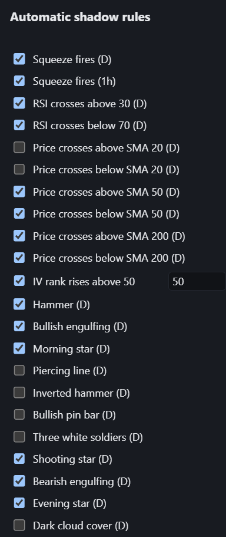
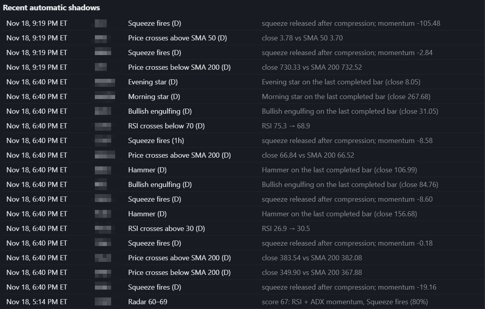

# Recording

[← User guide](README.md) · **More → Recording** (PC)

What Fillmark records in the background while it runs. When Fillmark isn't
running none of this happens, and those gaps can't be filled later, so the
first setting matters most.

## The screen

| Part | What it shows |
|---|---|
| **The top line** | How often it runs, the last run (with "running…" while one is going), how many shadows and position marks that run recorded, and any error. Read-only: nothing is sent to your account |
| **Start Fillmark with Windows** | [See below](#start-fillmark-with-windows) |
| **Open interest** | How many days and tickers of open interest are recorded so far |
| **Watchlist (testing)** | Tickers the shadow rules run on, traded or not |
| **Traded (automatic)** | Tickers in your fills from the last weeks plus any still open, kept up to date by itself; futures by product |
| **Run the rules on traded tickers too** | Also run the shadow rules on that list |
| **Mark open positions** | How often to store a mark of each open position: off, once after the close, hourly, or every 5 minutes |
| **Automatic shadow rules** | Each rule, on or off (scroll for the rest) |
| **Recent position marks** | The latest marks: when, the position, the underlying's price, open P/L, delta and theta in dollars, days to expiry, and the nearest short strike with how far the price is from it |

**Reading the example:** marking is **Off**, yet marks keep appearing: a
mark is also stored whenever an [open-position alert](alerts.md#open-positions)
fires, to record the position at that moment. So the marks here come from
alerts, a few times a day, not on a schedule. That's why [Exposure](exposure.md)
and [Taxes](taxes.md) can show old or missing marks: choose **once after the
close** or **hourly** to keep every open position marked.

## Start Fillmark with Windows

Tick it and Fillmark opens in the tray each time you sign in to Windows
(click the tray icon to show it). Closing the window only hides it;
recording keeps running in the tray. Off by default; this PC only.

## What it records

- **Price history** and the options' **IV history** for your symbols.
- **Open positions** (**Mark open positions**: off, once a day after the
  close, hourly, or every 5 minutes while the market is open): each open
  position's price, Greeks, open P/L (cash so far
  plus closing at mid now), delta in dollars per $1 move, theta in dollars
  per day, and the distance to the nearest short strike. It's permanent
  journal history, and it powers [open-position alerts](alerts.md#open-positions)
  and [Exposure](exposure.md). **Recent position marks** lists the latest.
  A mark is also stored whenever an open-position alert fires, even with
  marking off.
- **Automatic shadow rules**, each on or off: squeeze fires (daily and
  hourly), RSI crosses above 30 or below 70, price crosses its 20-, 50- or
  200-day average, IV rank above 50, and daily candle patterns. They run on
  your [watchlist](watchlist.md) and, with **Run the rules on traded tickers
  too**, on the tickers you've traded recently. Each firing is recorded
  once per ticker, rule and bar as a [shadow](snapshots.md). **Recent
  automatic shadows** lists the latest.

  

  Tick the rules you want recorded; **(D)** runs on daily bars, **(1h)** on
  hourly ones. **IV rank rises above** takes its own threshold (50 here).
  The candle patterns (Hammer to Dark cloud cover) are the bullish and
  bearish daily patterns. In the example the 20-day average crosses are off and several patterns are off; the rest
  record a shadow each time they fire, so [Study](study.md) can later show
  which signals worked.

  

  **Recent automatic shadows** (below the position marks): each row is one
  firing, with when, the ticker, the rule, and what it saw: "close 730.33 vs
  SMA 200 732.52" for a cross, "RSI 26.9 → 30.5" for an RSI cross, the
  squeeze's momentum when it released, or the close of a candle pattern.
  **Radar** rows are scheduled [Radar](radar.md) picks, with their score and
  the signals behind it. Each is followed up later to see how it did.

  A **Skipped (no bars)** line under the top line lists tickers the last run
  couldn't get bars for, so their rules didn't run that time.
- **Entry snapshots** when you open a position.
- **Scheduled [Radar](radar.md) scans**.
- **Open interest**: each trading day after 4:15 PM ET, open interest per
  strike for the watchlist (the nearest 4 expirations, strikes within 15%
  of the price; needs Tastytrade). The panel shows how many days are
  recorded. After a few weeks it can show whether support and resistance at
  big open-interest strikes holds better than the rest.

Recording runs every 5 minutes while Fillmark is open (also from the tray). **Run now** runs a round straight away. The panel shows the last run and
any error.

## On the phone

The phone pauses apps in the background, so the PC does the recording and
the phone gets the results through sync. The phone's Recording screen only
refreshes shadow outcomes.
