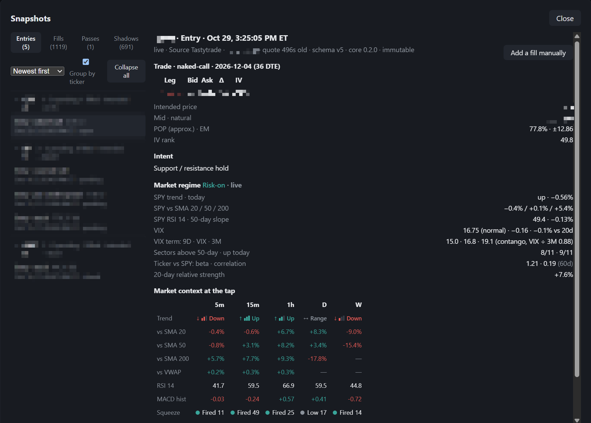

# Snapshots and shadows

[← User guide](README.md) · **Journal → Snapshots**

A snapshot is the market at one moment, kept for good: the chart on every
timeframe, the indicators, the trend state, the option backdrop and the
market regime. Fillmark takes one:

- **Intent**: when you plan a trade in [Build a trade](chart-panels.md#build-a-trade)
- **Entry** and **Exit**: when a position opens or closes
- **Pass**: a trade you looked at and skipped
- **Shadow**: a signal a rule fired on its own ([Recording](recording.md),
  [Radar](radar.md))

So later you can see what you saw then, and Study can compare what you took
with what you didn't.

## The snapshot viewer

**The tabs** split snapshots by kind, each with its count; they're never
mixed in one list:

| Tab | What's in it |
|---|---|
| **Entries** | The trades you planned in Build a trade (the intent, taken when you placed it) |
| **Fills** | The moment each position actually filled (live, or **rebuilt** from cached bars when Fillmark wasn't running) |
| **Passes** | Trades you looked at and skipped |
| **Shadows** | Signals a rule fired on its own (Recording, Radar) |

**The list** (left): sort newest or oldest first, by ticker, or by highest
credit; **Group by ticker** gathers them and **Collapse all** folds the
groups. A group's header counts its snapshots and how many are still
**pending** (planned, no fill matched yet) or **filled**, and adds up their
intended prices (**+** credit, **−** debit). Each row is the kind and
strategy (e.g. "Entry · naked-call · 2.95 cr"), when, and where the trade
stands: pending, open or closed.

**A snapshot** (right), top to bottom:

| Part | What it shows |
|---|---|
| **The heading** | Ticker, kind and the exact time (New York) |
| **The line under it** | **live** (taken at the moment) or rebuilt; the data source; the underlying's price; how old the quote was; the versions it was made with; **immutable**: a snapshot never changes after it's taken |
| **Add a fill manually** | Records what actually filled, pre-filled from the snapshot |
| **Trade** | The strategy, expiration and days to expiry, and each leg with its bid, ask, delta and IV at that moment |
| **Intended price**, **Mid · natural** | The price you meant to get, against the mid and the natural (the worse side of the bid/ask) |
| **POP (approx.) · EM** | An approximate probability of profit, and the expected move to expiry |
| **IV rank** | Where implied volatility stood in its 1-year range (0–100) |
| **Intent** | The setup you chose (here "Support / resistance hold"), and your plan and thesis if you wrote them |
| **Market regime** | The market's mood ([definitions](help.md#definitions)): Risk-on, Risk-off or Mixed, from SPY's trend and averages, its RSI, the VIX and its term structure, sector breadth, and the ticker against SPY (beta, correlation, 20-day relative strength) |
| **Market context at the tap** | The ticker on every timeframe at that moment: trend state, distance from its averages and VWAP, RSI, MACD histogram, squeeze and more, like [the chart's timeframe table](chart-panels.md) |

**Reading the example:** a naked call (selling one call, 36 days out) taken
live in a **risk-on** market: SPY trending up, VIX 16.75 and normal, in
contango, 8 of 11 sectors above their 50-day. The ticker itself was in a
daily range and a weekly downtrend, 17.8% under its 200-day: selling a call
above a ticker that's below its long-term average fits the "resistance
hold" intent. The market and the ticker are frozen exactly as they were,
so Study can later ask whether trades like this one work.

Each snapshot shows:

- **Intent → fill**: the price you intended against the one you got
  (credit-positive: + means better than planned), mid and natural price,
  credit ÷ width, an approximate probability of profit and the expected
  move.
- **Timeframes**: each timeframe's trend state, RSI, MACD histogram and
  distance from its averages.
- **Market regime**: SPY's trend, the VIX and its term structure, sector
  breadth, and the ticker against SPY.

**Add a fill manually** from a snapshot records what actually filled,
pre-filled from it. A position with no entry snapshot (opened while
Fillmark wasn't running) gets its context rebuilt from cached bars, marked
as reconstructed.

## If it had been traded

Shadows and passes get the trade they would have been:

- **Direction** follows the signal. Bullish: a put credit spread and long
  shares. Bearish: a call credit spread and short shares. No direction: the
  put spread.
- **Options**: short leg about 16 delta, 30–45 days out, 1% wide; exits at
  50% of the credit, 21 days to expiration, or expiry. **✓ Real options**
  means those strikes and that expiration were listed when the signal fired
  (checked against Tastytrade). **⚠ Modelled** means they weren't checked.
- **Stock (drift)**: the move after 1, 5, 10 and 20 trading days, the high
  and low in between, and what 100 shares the signal's way made. An index
  shows its move in points.

Later option prices are modelled from the stock's daily closes and recorded
IV: no historical option quotes exist.

## Related

- [Stats → Taken vs. passed vs. automatic](stats.md)
- [Recording](recording.md): the rules that make shadows
