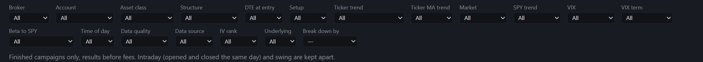
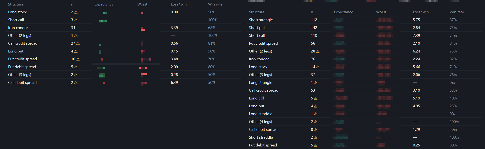
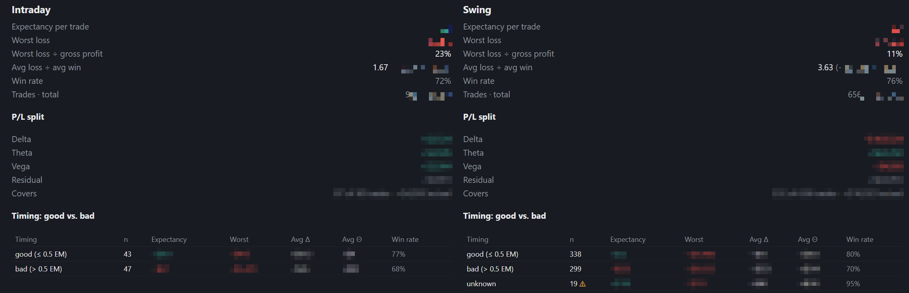

# Stats

[← User guide](README.md) · **Review → Stats**

Breakdowns of your finished campaigns, results before fees. Intraday
(opened and closed the same day) and swing are kept apart. Under 30 trades
it warns you (⚠).

From the top: the [filters and Break down by](#filters-and-break-down-by),
Taken vs. passed vs. automatic, then [Intraday and
Swing](#intraday-and-swing-side-by-side) side by side.

## Filters and Break down by

**Each dropdown is a filter**: pick a value to keep only those trades, and
every number on the page follows (your side of Taken vs. passed vs.
automatic, the Intraday and Swing summaries, the P/L split and timing).
Combine as many as you like: e.g. Structure = Short put and VIX = elevated
shows how short puts did when the VIX was elevated. **All** removes a
filter.

**Break down by** picks one dimension to split the trades by: a table then
appears under Intraday and under Swing, one row per value, with **n** (⚠
under 30 trades), **Expectancy**, **Worst**, **Loss÷win** (the average loss
÷ the average win) and **Win rate**.

**Reading the example** (Structure, swing on the right): the most-traded
structures (short strangle 112, short put 142, short call 110) all win
72–87% of the time, but their **Loss÷win** is 2.8–7.4: one average loser
costs as much as 3 to 7 average winners. Put credit spreads and iron condors
(84% and 82% wins, loss÷win about 2.1–2.2) have the defined risk that keeps
the losers in proportion. On the intraday side almost every row has ⚠: too
few trades yet to say anything.

The dimensions:

| Dimension | Groups by |
|---|---|
| Broker, Account | The broker and account of the opening order |
| Asset class | Options, futures, futures options, stock or crypto |
| Structure | From the opening legs: put credit spread, iron condor, long future… |
| Setup | The setup you gave the campaign |
| DTE at entry | Days to the nearest expiry at the open |
| Ticker trend, Ticker MA trend | The symbol's trend state and moving-average trend at entry |
| Market, SPY trend | The market regime and SPY's trend at entry |
| VIX, VIX term | The VIX level and its term structure at entry |
| Beta to SPY | How much the symbol moves with the market |
| Time of day | Entry time, New York: the open (9:30–10:30), midday (to 14:00), late |
| IV rank | The option's IV rank at entry |
| Underlying | The symbol |
| Data quality, Data source | How complete the snapshot behind the trade was |

The [Taken vs. passed vs. automatic](study.md#execution-and-taken-vs-passed-vs-automatic)
section comes next, as in Study.

## Intraday and Swing, side by side

Everything below is shown twice, **Intraday** on the left and **Swing** on
the right, because the two behave so differently that mixing them would
hide both.

**The summary** at the top of each: expectancy per trade, worst loss, worst
loss ÷ gross profit, avg loss ÷ avg win, win rate, and trades · total.

**Reading the example:** intraday trades lose 1.67× their average winner
when they lose, and the worst loss is 23% of all the gross profit; swing
trades lose 3.63× their average winner. Swing wins more often (76% against
72%) but the losers are much bigger: the size of the losers, not the
win rate, decides the result.

## P/L split

The result split into **delta** (direction, including gamma), **theta**
(time decay), **vega** (volatility), and the **residual** the model doesn't
explain: did you make money from being right, from time, or from volatility?
**Covers** says how many trades the split could be worked out for (e.g. "332
of 656 trades": the others had no option prices to model) and their actual
total, which the four lines add up to.

How to read it: a premium seller hopes for theta positive and the rest
small. A large negative **delta** with a positive **theta** means the time
decay earned was taken back by moves against the positions.

## Timing: good vs. bad

Trades split by how the first days went: **good** when the worst move
against the position in days 1–3 stayed within half an expected move (≤ 0.5
EM), **bad** when it went further, **unknown** without the data. Columns:
**n**, **Expectancy**, **Worst**, **Avg Δ** and **Avg Θ** (the average delta
and theta parts of the P/L split) and **Win rate**.

**Reading the example:** in both, good timing wins more often (77% against
68% intraday, 80% against 70% swing) and earns more per trade. Bad timing
loses through **delta**: the trade went against the entry early and never
recovered. Entering a little later, or in smaller size first, is what this
table argues for.

## Taken vs. passed vs. automatic

Your real campaigns, against your **passes** (each as the default credit
spread) and the **automatic rule shadows** (the credit spread their signal
points to), side by side. Is your judgment adding anything?

- **Which shadows**: all, or **real options only** (the shadows whose
  options were really listed at the signal, checked against Tastytrade's
  chain).
- Each rule shows how many were real, and its stock result after 10 trading
  days next to the options one.

## Related

- [Study](study.md)
- [Snapshots and shadows](snapshots.md)
