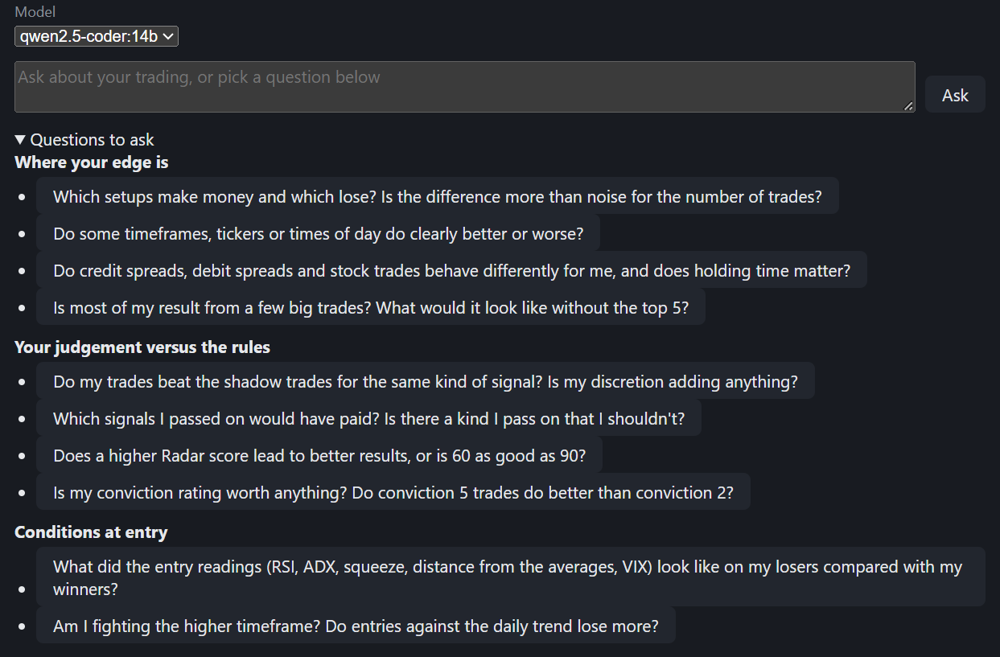

# Study with AI

[← User guide](README.md) · **Review → Study with AI**

An AI can find patterns you didn't think to ask about, and read your thesis
notes. Treat what it finds as ideas to check, not conclusions: with a few
hundred trades, some patterns are only noise.

## The screen

| Part | What it shows |
|---|---|
| **What goes in** | What the AI never gets (account numbers, broker names, logins) and four choices: **Tickers**, **Dates**, **My thesis notes**, **Dollar results**. Without dollars, results are in R. "Gathering…" while the export is being built, then its size |
| **Export for analysis** | **Save file…** or **Copy to clipboard**: the same data as one file for any AI |
| **Ask an AI** | Claude, ChatGPT, Gemini or a local model; the line under it says what that choice sends where and what it costs |
| **Free local AI (Ollama)** | Only with Local model: this PC's memory and graphics card, whether Ollama is running, the model loaded now, the models downloaded, and the one recommended for this PC with **Download** |
| **Model**, the question box (below) | Which model answers, and your question; suggested questions sit under the box |

**Reading the example:** the local model is picked, so nothing leaves the
PC. This PC has an 8 GB graphics card, so the 7B model (4.7 GB) is
recommended: it fits on the card and answers in seconds. Of the models already
downloaded, the 8B one fits too, but the 14B (9 GB) and 31B (19.9 GB) don't:
they run mostly on the processor, which takes minutes.

## Two ways in

- **Export for analysis**: saves (or copies) one file with your finished
  trades, the indicator readings and your intent at entry, every shadow and
  pass, and the definitions, to give any AI.
- **Ask an AI**: asks about the same file right there. It checks its numbers
  with a local stats tool (counts, win rate and R by any grouping, older
  trades against newer) before answering, and shows which checks it ran.
  Suggested questions are one tap away.

## Choosing an AI

Pick the AI, then its model (the list comes from the provider, so new
models show up by themselves):

| AI | Key from | Cost |
|---|---|---|
| **Claude** (Anthropic) | platform.claude.com | Billed to your Anthropic account: roughly 5–50 cents for a first question, much less for follow-ups |
| **ChatGPT** (OpenAI) | platform.openai.com | Billed to your OpenAI API account (separate from a ChatGPT subscription) |
| **Gemini** (Google) | aistudio.google.com | Billed to that project, or Google's free tier (where Google may use the prompts) |
| **Local model** (Ollama, PC only) | Nothing: runs on your PC | Free, and nothing leaves the PC |

Keys stay in this device's keychain (**Remove API key** deletes one). Each
question to Claude, ChatGPT or Gemini sends the export to that company.

## Privacy

Account numbers, logins and broker names never go in (brokers become
Broker A, B…), and results are in R rather than dollars. Tickers, dates,
your thesis notes and dollar results are your choice, on the same screen.

## Past conversations

Conversations are saved on this device as they go. **Past conversations**
lists the 10 most recent to continue (same AI and model, the journal as it
was then). A question that failed or was cut off has **Retry**. Switching
the AI or the model starts a new conversation.

## A free local AI (Ollama)

**Local model (Ollama)** shows your PC's memory and graphics card, whether
Ollama is installed and running, which models are downloaded, and which one
is loaded and how much of it sits on the graphics card.

1. **Install Ollama** (with your OK, through Windows' installer), or
   **Start Ollama**.
2. **Download** the model recommended for your PC (size shown first).
3. **Test it**: one short question, timed.

Speed depends on the graphics card: a model that fits in its memory answers
in seconds; one that doesn't can take minutes. On an 8 GB card that means a
7B model; 14B wants about 12 GB, 32B about 24 GB. Without a capable card, a
cloud AI is much quicker. The phone uses the cloud AIs only.

## Questions worth asking

**Model** picks which of the AI's models answers. Type a question and
**Ask**, or tap one under **Questions to ask** to send it as it is. They're
grouped by what they test:

| Group | What it asks |
|---|---|
| **Where your edge is** | Which setups, timeframes, tickers, times of day and trade types make or lose money, and whether a few big trades carry the result |
| **Your judgement versus the rules** | Whether your trades beat the [shadows](snapshots.md) of the same signal, which passed signals would have paid, whether the Radar score and your conviction rating mean anything |
| **Conditions at entry** | What the snapshot readings looked like on losers against winners, and whether trading against the daily trend costs you |
| **Behaviour** (scroll) | Whether you exit winners early and hold losers long, trade worse after a loss or a streak, and manage trades as planned |
| **From my own notes** (scroll) | What the theses on losing trades have in common, and your mistakes summed up as a few rules |
| **What to change** (scroll) | The one filter that would have helped most (and still helps on recent trades), and which recording or Radar rules never pay |

Some good ones to start with:

- Which setups make money and which lose, after fees? Is the difference
  more than noise?
- Do my trades beat the shadow trades for the same signal?
- Does a higher Radar score lead to better results?
- What did the snapshot look like at entry on my losers, compared with my
  winners?
- Do I exit winners too early and hold losers too long?
- What do the theses on my losing trades have in common?
- If I could add only one filter, which would have helped most, and would it
  still have helped on my most recent trades?

The best test: have the AI find a pattern in your older trades, then check
it on the newer ones it didn't see.

The same AI setup is used by the [Rebalancer's AI review](rebalancer.md) and
[AI paper trading](ai-paper-trading.md).
