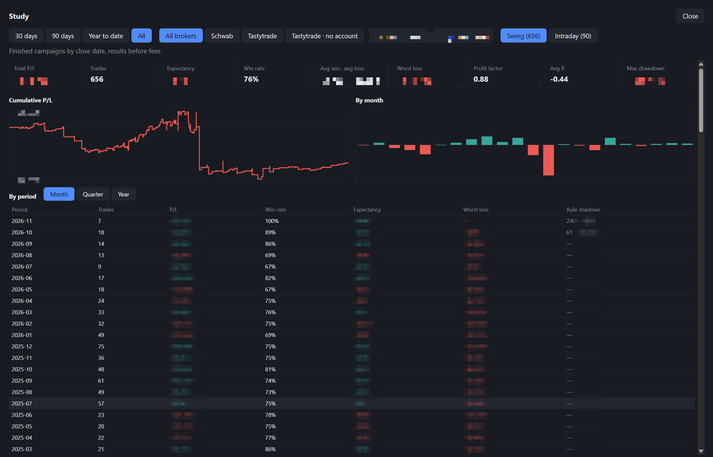
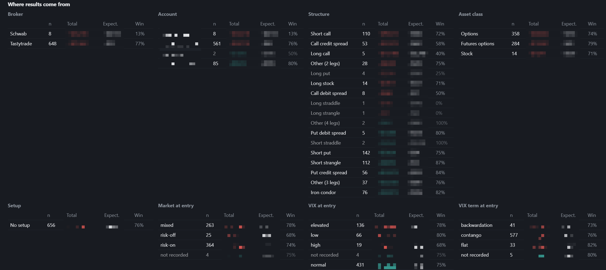
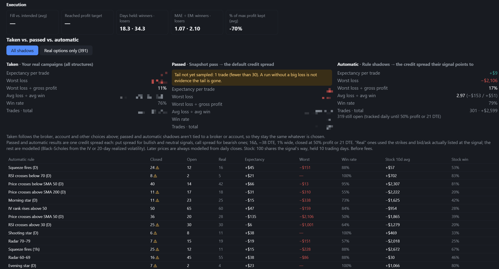
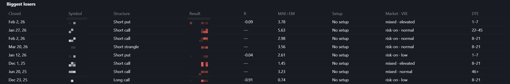

# Study

[← User guide](README.md) · **Review → Study**

How your trading is going and where results come from. Study looks at
**finished campaigns by close date**, results before fees.

## Choosing what to look at

- **Period**: 30 days, 90 days, year to date, or all.
- **Broker** and **account**: all brokers, one broker, or one account (with
  its nickname).
- **Swing** or **Intraday** (opened and closed the same day): kept apart,
  with how many of each.

## What it shows

**The filter row**: the period (30 days, 90 days, Year to date, All), the
broker or a single account (shown by nickname or last digits; "no account"
for fills that don't name one), and **Swing (656)** / **Intraday (90)**:
the trades of each kind in the period.

**The headline tiles:**

| Tile | What it means | How to read it |
|---|---|---|
| **Total P/L** | The sum of the results | — |
| **Trades** | Finished campaigns in the view | Under about 30, treat everything as noise |
| **Expectancy** | The average result per trade | Above $0: the way you trade makes money on average |
| **Win rate** | The share of trades that made money | Means little alone: see the next tile |
| **Avg win · avg loss** | The average winner and the average loser | A 76% win rate with losers 3–4× the winners can still lose overall |
| **Worst loss** | The single largest loss | One trade can undo months |
| **Profit factor** | Gross profit ÷ gross loss | Above 1 makes money; 0.88 means $0.88 won per $1 lost |
| **Avg R** | The average [R multiple](campaigns.md#the-columns) | −0.44: on average a trade gave back 44% of what it risked |
| **Max drawdown** | The largest drop from a peak in cumulative P/L | How deep the worst stretch went |

**Reading the example:** a high win rate (76%) but a profit factor of 0.88
and an average R of −0.44: the wins are many but small, the losses few but
large. That's the classic pattern of selling premium without cutting
losers, and it's what the *Biggest losers* and *Execution* sections below
help you dig into.

**Cumulative P/L** (left) is the running total, one step per closed trade;
**By month** (right) is each month's result, green up and red down. The
example's single deep red month is the drop in the line.

**By period**: each month (or **Quarter**, **Year**) on its own row: trades,
P/L, win rate, expectancy, worst loss, and **Rule shadows**: how many
automatic shadows closed that period and their modelled P/L (e.g. "240 ·
…"), to compare what you did with what the rules alone would have.

### Where results come from

The same trades, grouped one way per table. Every table has the same
columns: **n** (trades), **Total**, **Expect.** (expectancy, the average per
trade) and **Win** (win rate). Rows run from the worst total to the best.
A gray row has fewer than 5 trades: an anecdote, not a result. Even a
normal row needs about 30 trades before its numbers mean much.

| Table | Groups by |
|---|---|
| **Broker**, **Account** | Where the trade was |
| **Structure** | The kind of position: short put, iron condor, call credit spread, long stock… ("Other (3 legs)" for combinations without a name) |
| **Asset class** | Options, futures options, stock, futures, crypto |
| **Setup** | The setup you chose when you entered ("No setup" when none was recorded) |
| **Market at entry** | The [market regime](help.md#definitions) when it opened: risk-on, mixed, risk-off |
| **VIX at entry** | Low, normal, elevated or high |
| **VIX term at entry** | Contango, flat or backwardation |
| **DTE at entry**, **Time of day**, **IV rank**, **Symbol** | Further down: days to expiry when opened, the time it opened (inside or outside the regular session), IV rank at entry, and the underlying |

**Reading the example:** the counts and win rates already say a lot. Short
calls (110 trades, 72% wins) and call credit spreads (58%) sit at the top of
the table, among the worst totals; short puts, strangles, put credit spreads
and iron condors (75–87% wins) are at the bottom, among the best. All 656
trades have **No setup**, so the setup table can't help yet: recording a
setup with each entry is what makes it useful. And "not recorded" rows are
trades from before Fillmark recorded the market at entry.

### Execution, and taken vs. passed vs. automatic

**Execution** is how you handle a trade once you're in it:

| Tile | What it means |
|---|---|
| **Fill vs. intended (avg)** | Your fill against the price you planned in Build a trade (+ is better). — until trades are planned there |
| **Reached profit target** | How often trades with a planned target got there. — until you record plans |
| **Days held: winners · losers** | Average days held. In the example 18.3 · 34.3: losers are held almost twice as long as winners, the classic "letting losers run" |
| **MAE ÷ EM: winners · losers** | How far trades went against you, in expected moves. Losers at 2.10 went twice as far against you as winners (1.07) before you were out |
| **% of max profit kept (avg)** | Credit trades: the result ÷ the credit received, averaged. 50% means half the credit kept; −70% means that on average a trade lost an amount equal to 70% of its credit |

**Taken vs. passed vs. automatic** puts three things side by side:

- **Taken**: your real campaigns (following the broker and account chosen
  above).
- **Passed**: trades you snapshot as a pass, each turned into the default
  credit spread, to see what skipping them saved or cost.
- **Automatic**: the rule shadows from [Recording](recording.md) and
  [Radar](radar.md), each as the credit spread its signal points to.

Each shows expectancy, worst loss, **worst loss ÷ gross profit** (how much of
all the profit one bad trade erased), **avg loss ÷ avg win** (3.63 means the
average loser is 3.6 times the average winner), win rate, and trades and
total. A yellow box warns when a column has under 30 trades: a run without a
big loss isn't evidence the risk is gone. **Real options only** limits the
shadows to ones whose strikes were really listed at the signal.

The automatic shadows in the example: +$9 a trade, 79% wins, a worst loss
of $2,106, over 301 closed, with 319 still open (tracked daily until 50%
profit or 21 DTE).

**The rule table** shows each automatic rule on its own:

| Column | What it means |
|---|---|
| **Closed** | Shadows closed. ⚠: fewer than 30, too few to judge |
| **Open** | Still being tracked |
| **Real** | How many used options actually listed at the signal (the rest are modelled) |
| **Expectancy**, **Worst**, **Win rate** | The credit spread's results |
| **Stock 10d avg**, **Stock win** | The same signal traded as 100 shares for 10 trading days instead |

**Reading the example:** "Price crosses below SMA 50 (D)" has 40 closed
(enough to start trusting), 95% wins, +$66 a trade and a worst loss of $13;
"Price crosses above SMA 50 (D)" loses $135 a trade with a $2,106 worst
loss. Rules marked ⚠ need more time before they mean anything.

### Biggest losers

The trades that cost the most, largest first, to read again: when it
closed, the symbol, the structure, the result, **R**, **MAE ÷ EM** (how
many expected moves it went against you), the setup, the market regime and
VIX at entry, and the DTE bucket at entry.

**Reading the example:** almost every big loser is a short option (short
calls, short puts, a short strangle) that moved 2–6 expected moves against
the position: the "fat tail" that a 76% win rate hides. Their **R** is
"—" or close to 0 because a naked short option's max loss is unlimited (or
huge), so R can't measure them. None had a setup recorded, and most were
opened in a calm, risk-on market, a reminder that a quiet market at entry
is no protection.

- **The headline numbers**: total P/L, trades, expectancy (the average
  result per trade), win rate, average win · average loss, worst loss,
  profit factor (gross profit ÷ gross loss) and max drawdown (the largest
  drop from a peak).
- **Cumulative P/L** and **P/L by month**.
- **Where results come from**: the results grouped by broker, account,
  structure, asset class, setup, market at entry, VIX and VIX term at
  entry, DTE at entry, time of day, IV rank or symbol. Each row: trades, total, expectancy and
  win rate.
- **Execution**: your fill against what you intended, how often trades
  reached their planned profit target, days held for winners against
  losers, MAE ÷ expected move for winners against losers, and the % of max
  profit kept (credit trades).
- **Biggest losers**: the trades that cost the most, to read again.
- **By period**: each month, quarter or year side by side.
- **Rule shadows**: the automatic shadows that closed in the period, with
  their count and modelled P/L (one default spread each), next to yours.

With fewer than about 30 trades in a group, treat the numbers as noise.

## Related

- [Stats](stats.md): more ways to break results down
- [Study with AI](study-with-ai.md): ask an AI about the same journal
