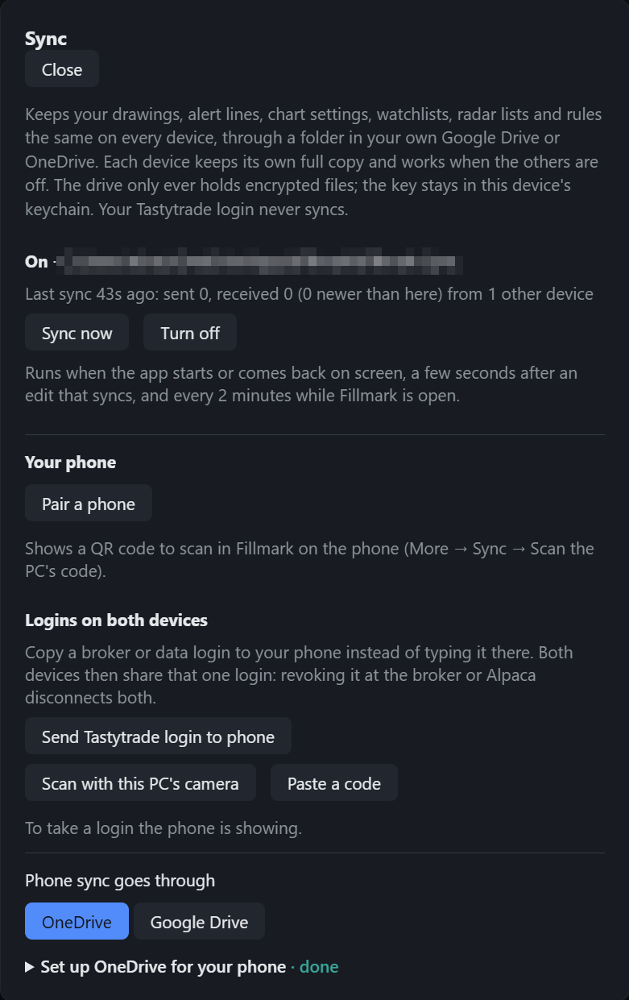

# Sync and the phone

[← User guide](README.md) · **More → Sync**

Your journal (fills, campaigns, snapshots, Radar picks), drawings, alert
lines, alerts, settings, watchlists, baskets and license stay the same on
your PC and phone. Each device keeps its own full copy and works while the
other is off; the cloud (your own OneDrive or Google Drive) only holds
encrypted files that only your devices can read.

## The Sync screen (PC)

From the top:

| Part | What it shows or does |
|---|---|
| **On · folder** | Sync is on, and the cloud folder it uses (here in OneDrive; pixelated). "Off" with a Turn on button when it isn't |
| **Last sync 43s ago: sent 0, received 0 (0 newer than here) from 1 other device** | When this device last synced; how many changes it sent and received; how many of those were newer than what this device had (older ones are ignored, the newest edit wins); and how many other devices share the folder |
| **Sync now** | Syncs right away instead of waiting |
| **Turn off** | Stops syncing on this device; its own copy stays |
| **Your phone → Pair a phone** | Shows the QR code the phone scans (More → Sync → Scan the PC's code). It carries the sync key: pair in private |
| **Logins on both devices** | **Send Tastytrade login to phone** shows a one-time code for the phone; **Scan with this PC's camera** or **Paste a code** takes one the phone is showing. Both devices then share the one login, so revoking it at the broker disconnects both |
| **Phone sync goes through** | Which cloud the phone uses: **OneDrive** or **Google Drive**. **Set up … for your phone · done** opens the one-time registration guide; "done" means it's set up |

**Reading the example:** sync is on through OneDrive, it last ran 43 seconds
ago, nothing new either way, and one other device (the phone) shares the
folder.

## Setting up

1. **Once: register Fillmark with your cloud.** Help → "Set up OneDrive or
   Google Drive" walks you through it (the same guide is on the Sync
   screen). Paste the ID it gives you into **More → Sync** on the PC.
2. **On the PC**:
   - OneDrive: **Turn on sync** (your OneDrive folder is found
     automatically).
   - Google Drive: **Sign in to Google Drive** (a short code at
     google.com/device), then **Turn on sync through Google Drive**.
   - Then **Pair a phone** to show a QR code.
3. **On the phone**: install Fillmark, then **More → Sync → Scan the PC's
   code** (or **Paste it instead**). Sign in to the same cloud with the short
   code it shows, then **Turn on sync**. With Google, if it says the app
   isn't verified: **Advanced → Go to Fillmark**.
4. **PC, OneDrive only**: once `OneDrive\Apps\Fillmark` appears, **Move sync
   to Apps\Fillmark** so both meet in the same place.

**Pair in private.** The QR code carries the key that unlocks your sync
files: don't show it on a shared screen or in a screenshot.

## When it syncs

When Fillmark opens or comes back on screen, a few seconds after you change
something that syncs, and every 2 minutes. The phone pauses Fillmark in the
background, so open it to bring it up to date. The Alerts screen shows how
long ago the last sync was ("Synced 20s ago", or "Sync failed" with the
reason on hover). What arrives shows by itself, without a reload.

## Who does what

- **The PC** records, scans, watches open positions and raises
  open-position alerts; the phone gets them through sync and notifies you
  of new ones. "Got it" on either device clears an alert on both.
- **Each device** computes campaign results and shadow outcomes itself.
- **Pairing again** takes the PC's settings over the phone's.
- **Logins don't sync**: send one with **Send … to phone / to PC** (see
  [Connections](connections.md#on-your-other-device)).
- AI paper trading stays on the PC.

## Installing the phone app

- **From Google Play** (when available): install like any app.
- **Over USB from the PC** (test builds): turn on Developer options and USB
  debugging on the phone (on Samsung, turn Auto Blocker off for the install,
  then back on), connect by USB and allow debugging. Your phone's data stays
  across updates.

On the phone, lists show as cards, the panels beside the chart are tabs,
and the market tools are free; the journal unlocks with your PC's license
once paired ([License](license.md)).
