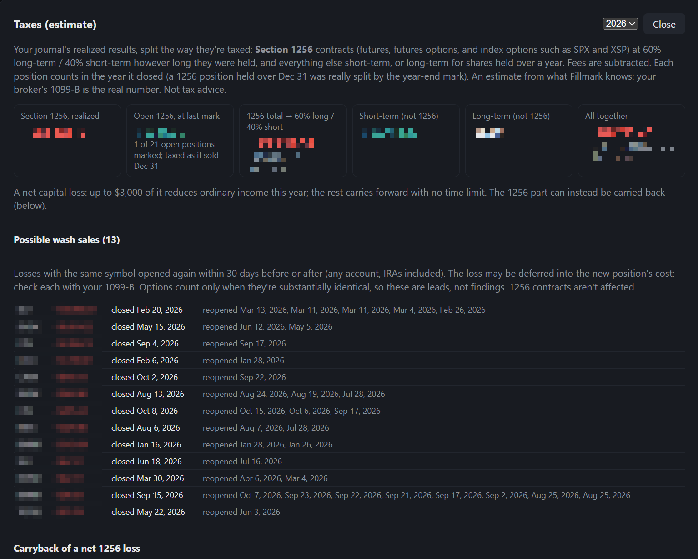
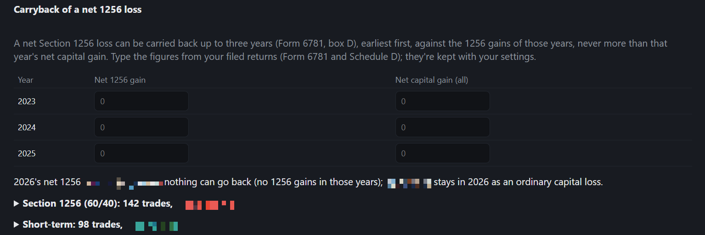

# Taxes (estimate)

[← User guide](README.md) · **Review → Taxes (estimate)**

Splits a year's realized results the way they're taxed in the US. It's an
estimate from your journal (fees included): your broker's 1099-B is the
real number, and none of this is tax advice.

## The screen

**The year** (top right) picks the tax year: a position counts in the year
it closed.

**The six tiles:**

| Tile | What it adds up |
|---|---|
| **Section 1256, realized** | Closed futures, futures options and index options |
| **Open 1256, at last mark** | 1256 positions still open, valued at their latest mark, because they're taxed as if sold on Dec 31. "1 of 21 open positions marked": only one had a mark; the others count as nothing until they're marked, so this tile can be incomplete |
| **1256 total → 60% long / 40% short** | The two above together, and that total split 60/40 |
| **Short-term (not 1256)** | Everything else held a year or less |
| **Long-term (not 1256)** | Shares held over a year |
| **All together** | The sum, split into the short-term and long-term parts that go on your return |

Under the tiles, a note says what the total means. Here it's a net capital
loss: up to $3,000 of it reduces ordinary income this year, the rest
carries forward, and the 1256 part can instead be [carried
back](#carryback).

**Possible wash sales (13)**: each row is a loss and the symbol (pixelated),
the day it closed, and every day the same symbol was opened again within
30 days before or after, in any account (IRAs too). If it's really a wash
sale, the loss isn't lost: it's added to the new position's cost. Options
count only when "substantially identical", so check each against your
1099-B.

## Section 1256

Futures, futures options and broad-based index options (SPX, XSP, NDX, RUT,
VIX…) are taxed **60% long-term / 40% short-term** however long they were
held. Positions still open on December 31 are taxed as if sold that day:
the screen adds open 1256 positions at their latest mark. They aren't
subject to the wash-sale rule.

SPY, QQQ and IWM options are ETF options, **not** 1256.

## Everything else

Short-term, or long-term for shares held over a year. A net capital loss
reduces ordinary income by up to $3,000 a year; the rest carries forward
with no time limit.

## Possible wash sales

Losses (not 1256) where the same symbol was opened again within 30 days
before or after, in any account. Leads to check against your 1099-B, not
findings.

## Carryback

A net 1256 loss can go back up to three years (Form 6781, box D), earliest
year first, never more than each year's net 1256 gain or its net capital
gain. Type those years' figures from your returns, and the screen shows how
much each year would take and what's left. Prior years' figures sync to your
other devices.

- **The table**: one row per prior year. **Net 1256 gain** is from that
  year's Form 6781; **Net capital gain (all)** from its Schedule D.
- **The result line** says how much of this year's 1256 loss each year can
  take back, and what stays in this year. In the example the boxes are 0, so
  "nothing can go back (no 1256 gains in those years)" and the whole loss
  stays this year as an ordinary capital loss. Fill in real figures and the
  line changes.
- **Section 1256 (60/40): 142 trades** and **Short-term: 98 trades** (▶):
  click to list the year's trades behind each total, to check them against
  your 1099-B.
