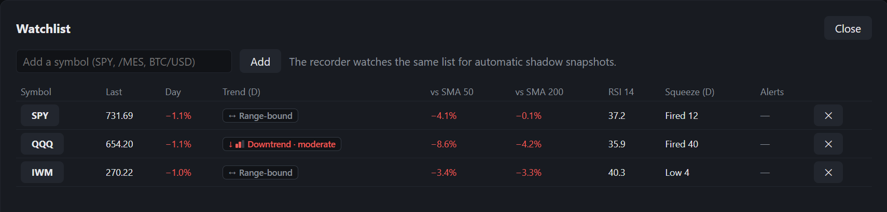

# Watchlist

[← User guide](README.md) · **Markets → Watchlist**

Your symbols at a glance, all from **daily bars**: where price is, which way
it's trending, how stretched it is, and whether volatility is coiling.

## The parts of the screen

| Part | What it does |
|---|---|
| **Add a symbol** box + **Add** | Adds a stock, ETF, future (`/MES`) or crypto pair (`BTC/USD`). |
| The note beside it | A reminder that [Recording](recording.md) watches this same list. |
| The table | One row per symbol, the columns below. |
| **Symbol** button | Click it to open that symbol on [the chart](chart.md). |
| **✕** | Removes the symbol from the list. |

## The columns

| Column | What it shows | How to read it |
|---|---|---|
| **Last** | The latest price (the last daily close, or today's price while the market is open) | — |
| **Day** | Today's change from yesterday's close | Green up, red down |
| **Trend (D)** | The daily [trend state](#the-trend-chip): Uptrend, Downtrend or Range-bound, with its strength | A description of price, not a buy or sell call. Hover it for the ADX and the votes |
| **vs SMA 50** | How far price is above (+) or below (−) its 50-day average | The medium-term trend. Far above: stretched; below: under pressure |
| **vs SMA 200** | The same against the 200-day average | The long-term trend. Below the 200-day is widely read as a bear phase for that symbol |
| **RSI 14** | Relative Strength Index, 0–100, over 14 days | Above 70 overbought, below 30 oversold, around 50 neutral |
| **Squeeze (D)** | The daily [squeeze](#the-squeeze-column): is volatility compressed, and for how long, or how many days since it released | See below |
| **Alerts** | 🔔 and the number of armed [alerts](alerts.md) on this symbol (price, line and indicator alerts) | — means none |

### The trend chip

The arrow and bars show direction and strength:

| Chip | Meaning |
|---|---|
| ↑ ▮▯▯ **Uptrend · weak** / **moderate** / **strong** | More of the four votes point up |
| ↓ ▮▮▯ **Downtrend · …** | More point down |
| ↔ **Range-bound** | A tie, or ADX under 18 (no real trend whatever else says) |

**Strength** comes from ADX 14: 18–25 weak, 25–40 moderate, 40+ strong.
**Direction** is a vote of four: +DI vs −DI; the 20-day average vs the
50-day; the 20-day average rising or falling over 20 days; and the last two
swing highs and lows both higher or both lower. It needs 50 days of bars.

### The squeeze column

The squeeze compares Bollinger Bands (20, 2) with Keltner Channels (20).
When the bands sit inside the channels, volatility is compressed, which often
comes before a big move.

| Shows | Meaning |
|---|---|
| **High 3** | The tightest compression (inside the 1.0× channel), for 3 days so far |
| **Mid 5** | The classic squeeze (inside the 1.5× channel), 5 days so far |
| **Low 4** | A loose compression (inside the 2.0× channel), 4 days so far |
| **Fired today** | The compression ended on today's bar: the move may be starting |
| **Fired 12** | It ended 12 days ago |
| **Off** | No compression, and no recent release |

## Reading the example

In the screenshot:

- **SPY** is down 1.1% today and **range-bound**. It's 4.1% under its 50-day
  average but only 0.1% under its 200-day: a pullback that is sitting right
  on the long-term average. RSI 37.2 is weak but not oversold. Its squeeze
  fired 12 days ago, so the compression already released.
- **QQQ** is in a **moderate downtrend**, 8.6% under its 50-day and 4.2%
  under its 200-day: the weakest of the three. RSI 35.9.
- **IWM** is range-bound, 3.3–3.4% under both averages, and its squeeze is
  **Low 4**: volatility has been compressing for 4 days.
- None of them has an armed alert (—).

## What else uses the list

The watchlist does more than list:

- [Recording](recording.md) runs its automatic shadow rules on it.
- [Radar](radar.md) scans it (on by default).
- Open interest is recorded for it each day after the close.

It syncs to your other devices. The exact rules for each column are in
**Help → Definitions** (Trend state, RSI 14, Squeeze, SMA).
